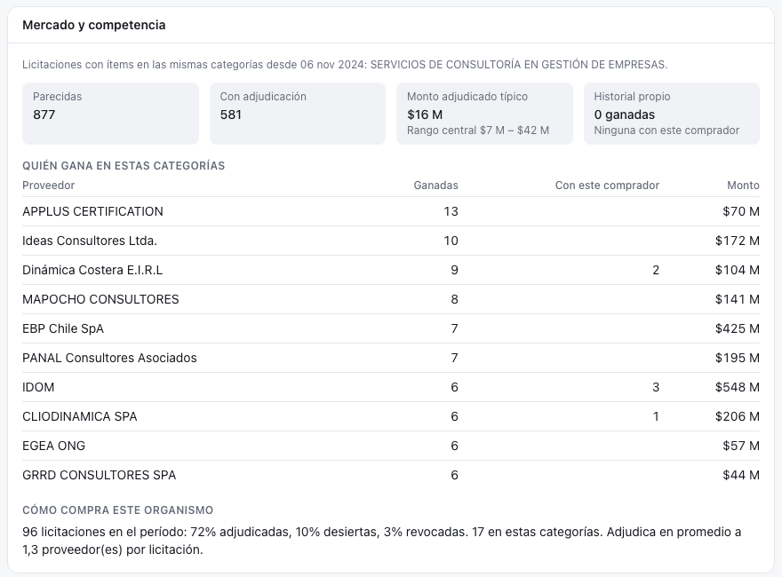

# Organismos {#sec-digest-organismos}

Decidir si postular no depende solo de si la licitación calza: también importa **contra quién se compite**, **cuánto se suele pagar** y **cómo se comporta el comprador**. Radar MP responde esas preguntas con el histórico de Datos Abiertos (~1,06 millones de líneas adjudicadas) en el panel **Mercado** del detalle de cada licitación.

::: {.captura}
{width="100%"}
:::

## Qué se calcula

El módulo `backend/src/radar/market.py` (`market_for`) toma las clases UNSPSC de los ítems de la licitación y busca, en una ventana de **24 meses** (`months`), licitaciones con ítems en esas mismas clases.

| Bloque | Contenido |
|---|---|
| **Competencia** | Proveedores que más ganan en esas categorías, cuántas veces con este comprador y si son universidades o la propia UAI |
| **Montos de referencia** | Monto adjudicado típico (mediana) y rango central; comparación con el presupuesto de la licitación |
| **Comportamiento del comprador** | Porcentaje de licitaciones del organismo adjudicadas, desiertas y revocadas |
| **Historial propio** | Adjudicaciones de la UAI (RUT en `proveedores_propios`) |

: Bloques de la vista de mercado {#tbl-mercado}

Ejemplo: un estudio que presupuesta $80 millones frente a $16 millones típico en su categoría es una señal de que el alcance es mayor de lo habitual o de que el comprador sobrestima.

La consulta responde en menos de 1 segundo y se expone en:

```
GET /profiles/{id}/matches/{codigo}/mercado?months=24
```

## Limitaciones

- La coincidencia por clase UNSPSC es **gruesa**: dos licitaciones de «servicios de consultoría» pueden ser muy distintas. Es una aproximación barata que cubre todo el histórico sin embeddings.
- Las adjudicaciones vienen solo de Datos Abiertos, con un mes de desfase.
- Las universidades se reconocen por el nombre del proveedor.

::: {.callout-tip}
## Por completar

- **Ficha de organismo**: página propia por comprador con sus licitaciones afines al centro, tasa de desiertas, montos y proveedores habituales. [pendiente]{.pendiente}
- **Digest de organismos**: resumen periódico de los organismos que más compran servicios del catálogo, por región y sector. [pendiente]{.pendiente}
- Competencia por **similitud semántica** (licitaciones parecidas, no solo de la misma clase). [pendiente]{.pendiente}
- Probabilidad de adjudicación y calendario estacional de compras por organismo ([Trabajos futuros](../futuro/index.qmd)).
:::
