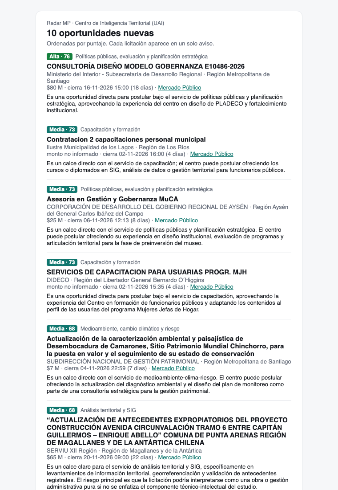

# Usuarios {#sec-digest-usuarios}

Dentro de cada unidad hay personas que revisan oportunidades y deciden si postular. Este capítulo explica cómo les llega la información y cómo su criterio vuelve a la plataforma.

## Dos formas de recibir oportunidades

- **El correo diario** llega sin que la persona lo pida. Sirve para enterarse.
- **La bandeja web** se consulta cuando se quiere. Sirve para revisar con calma, filtrar y etiquetar ([Bandeja](../plataforma/bandeja.qmd)).

## El correo diario

Después del matching, la plataforma arma un correo con las oportunidades **nuevas** del día. Para cada una muestra prioridad, servicio, puntaje, comprador, monto, fecha de cierre y el resumen escrito por el juez, con enlaces a la bandeja y a la ficha en Mercado Público (@fig-correo).

::: {.captura}
{#fig-correo width="55%" fig-align="center"}
:::

Tres reglas evitan que el correo se vuelva ruido:

1. Solo incluye las **prioridades elegidas** (por defecto, alta y media).
2. Solo incluye licitaciones **abiertas**.
3. Cada licitación se avisa **una sola vez**: la tabla `alert` registra lo ya enviado.

El 27 de octubre, el correo del CIT habría incluido la consultoría de la Subdere con su resumen: *«Es una oportunidad directa para postular bajo el servicio de políticas públicas y planificación estratégica…»*.

### Cómo se envía

El correo puede ir de dos formas:

- **Personal**: cada persona marcada para el correo diario recibe el suyo, sin las licitaciones que ya recibió. Se coordina en [Operación → Correos a usuarios](../plataforma/operacion.qmd#correos-a-usuarios), con vista previa por persona e historial de envíos.
- **Lista fija**: un mismo correo para una lista de direcciones, configurada en [Configuración → Alertas por email](../plataforma/configuracion.qmd#alertas-por-email).

Si la plataforma tiene un canal de envío configurado (`SMTP_*` en `.env`, o una API de correo por HTTPS con `MAIL_PROVIDER`), el correo llega a las casillas. Si no, se guarda como archivo `.eml` en el servidor, para revisarlo antes de activar el envío real; ese correo no cuenta como recibido.

```bash
uv run radar digest --preview digest.html   # vista previa en un archivo
```

### Qué se configura

Por unidad: si el correo sale solo con la rutina diaria, si va a las personas marcadas o a la lista fija, qué prioridades se avisan y si solo se incluyen las abiertas. Los días y la hora de la rutina se eligen en [Operación → Programación automática](../plataforma/operacion.qmd#programación-automática).

## El ciclo de retroalimentación

En el detalle de cada licitación hay cuatro botones, que también se activan con una tecla:

| Botón | Tecla | Qué se guarda | Significa |
|---|---|---|---|
| 👍 Relevante | `1` | `relevante` | Sirve a la unidad |
| 👎 No relevante | `2` | `no_relevante` | No sirve |
| ? Dudoso | `3` | `dudoso` | No está claro; requiere conversar |
| ✈ Postular | `p` | `relevante` + `postulado` | Sirve y la unidad decidió preparar una oferta |

: Botones de retroalimentación {#tbl-etiquetas}

Los botones aparecen para las personas con rol **jefatura** o superior ([Usuarios](../plataforma/usuarios.qmd)). Repetir el mismo botón quita la etiqueta. Cada licitación tiene **una sola etiqueta vigente por unidad**: si otra persona marca otra cosa, la última gana. Todas las marcas quedan además en el historial de la persona que las puso, con la hora.

### ¿Qué pasa cuando alguien hace clic en 👍?

Lo primero que hay que saber es lo que **no** pasa: el clic **no cambia el puntaje** de esa licitación, **no la vuelve a juzgar** y **no reentrena** ningún modelo. La licitación sigue en el mismo lugar de la bandeja. Lo único inmediato es que la etiqueta queda guardada y se puede filtrar («Etiqueta: Relevantes»).

La etiqueta sirve **después**, de tres formas:

**1. Como caso de referencia para el juez (desde el día siguiente).** Cuando el juez evalúa una licitación nueva, la plataforma busca entre las ya etiquetadas las que más se le parecen —coseno entre licitaciones de al menos 0,55, con los mismos *embeddings* de la [búsqueda por significado](../matching/embeddings.qmd)— y le muestra hasta cuatro, mitad relevantes y mitad no. Por ejemplo, si el equipo marca 👍 en *Actualización plan regulador comuna de Hijuelas* (`3775-35-LP26`), una licitación como *Actualización PLADECO comuna de Natales*, que se le parece con coseno 0,57, llegaría al juez con esta línea extra en sus instrucciones:

```text
Casos parecidos ya evaluados (referencia del criterio del equipo;
juzga esta licitación por su propio contenido):
- "ACTUALIZACIÓN PLAN REGULADOR COMUNA DE HIJUELAS" → RELEVANTE
```

Un 👎 funciona igual, pero como ejemplo de lo que **no** sirve. Así el criterio del equipo entra en las decisiones sin reentrenar nada, y en el detalle de la licitación nueva se ven los casos que consultó el juez. Solo afecta a lo que se juzgue de ahí en adelante; para aplicarlo a días pasados hay que reprocesarlos con `--rejudge`.

**2. Para calibrar los umbrales (cuando hay suficientes).** Con al menos diez licitaciones marcadas 👍 y diez 👎, Configuración → Aprendizaje compara las etiquetas con el puntaje final y sugiere los umbrales de prioridad: el de **media** que mejor equilibra precisión y recall, y el de **alta** que asegura al menos 80 % de precisión. También muestra en qué paso quedaron las licitaciones que el equipo marcó relevantes y el sistema no priorizó (reglas, triaje, juez). La sugerencia no se aplica sola: alguien tiene que presionar *Usar sugerencia* ([Modelos de priorización](../matching/priorizacion.qmd)).

**3. Para medir si la plataforma acierta.** Las etiquetas son la respuesta correcta contra la que se calculan la precisión y el recall del sistema, y en [Usuarios](../plataforma/usuarios.qmd) se ve cuántas etiquetas puso cada persona.

| Etiqueta | Caso para el juez | Calibración | Métricas |
|---|---|---|---|
| 👍 Relevante | positivo | positivo | positivo |
| ✈ Postular | positivo | positivo | positivo (además queda marcada como postulada) |
| 👎 No relevante | negativo | negativo | negativo |
| ? Dudoso | no se usa | no se usa | no se usa |

: Para qué sirve cada etiqueta {#tbl-etiquetas-uso}

«Dudoso» sirve para organizar el trabajo del equipo, pero no enseña nada a la plataforma; conviene resolverlo después a 👍 o 👎.

### Qué etiquetar para que sirva

- **Etiquetar también lo que no sirve.** Un 👎 en una licitación con prioridad alta es la señal más útil: muestra un error del sistema. Si solo se marcan las buenas, la calibración no tiene con qué comparar.
- **Revisar de vez en cuando las otras vistas.** Las etiquetas de la bandeja se concentran en puntajes altos. Una oportunidad marcada 👍 en «Descartadas por el juez» o «Excluidas por filtro» muestra qué se está perdiendo.
- **Usar «Postular» cuando corresponda.** Hoy cuenta igual que 👍, pero deja registrado qué se decidió postular, la base para [aprender de las postulaciones](../futuro/aprendizaje-postulaciones.qmd).
- **Comentar el porqué cuando sea posible.** El juez también ve el comentario de cada caso («no: es venta de equipos»). Hoy la bandeja no tiene un campo para escribirlo; los comentarios entran por la planilla de etiquetado (`radar eval`).

Una persona que etiqueta diez licitaciones a la semana mejora la bandeja de todo su equipo.

::: {.callout-warning}
## Pendiente para el uso real

- Marcar a las personas del CIT para el correo diario y activar el envío automático. El canal SMTP ya funciona: los primeros correos llegaron el 30 de octubre. [pendiente]{.pendiente}
- Comenzar a etiquetar: hoy no hay etiquetas del equipo, así que el juez todavía no recibe casos de referencia y la calibración no tiene datos. [pendiente]{.pendiente}
- Agregar un campo de comentario en la bandeja. [pendiente]{.pendiente}
- Preferencias personales (servicios, regiones, frecuencia) y resúmenes semanales son parte de [Trabajos futuros](../futuro/index.qmd).
:::

::: {.callout-tip}
## En resumen

- Las personas reciben un correo diario sin repeticiones y revisan la bandeja cuando quieren.
- Un 👍 o 👎 no cambia nada al instante: enseña al juez desde el día siguiente, calibra los umbrales y mide los aciertos.
- La parte siguiente, **Plataforma**, muestra la web en detalle.
:::
