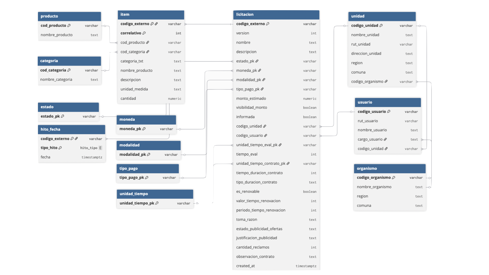

# Diseño general {#sec-diseno}

Este capítulo da la vista completa antes de entrar en detalle: qué conceptos usa la plataforma, por qué etapas pasa una licitación y qué piezas técnicas hacen el trabajo.

## Conceptos clave

Seis palabras se repiten en todo el libro:

| Concepto | Qué es |
|---|---|
| **Licitación** (u oferta pública) | Una compra que publica el Estado en Mercado Público. Se identifica por un código como `1351461-5-LR25`. |
| **Organismo comprador** | La institución pública que compra: un municipio, un gobierno regional, un ministerio o un servicio. |
| **Unidad UAI** | Un centro o facultad de la universidad que podría postular, como el CIT. |
| **Perfil** | La descripción de lo que busca una unidad: sus servicios, sus reglas de exclusión y sus criterios de orden. Hoy existe el perfil `cit`. |
| **Servicio** | Una línea de trabajo de la unidad (por ejemplo, «Análisis territorial y SIG»), descrita con un texto, ejemplos de licitaciones y palabras clave. |
| **Match** | El resultado de evaluar una licitación contra un perfil: puntajes, decisión de cada modelo y prioridad final. |

: Conceptos clave {#tbl-conceptos}

Hay que distinguir dos tipos de organismo. Los **organismos compradores** son los clientes, del lado del Estado, y se estudian en la parte de [Ingest](ingest/organismos.qmd). Las **unidades UAI** son quienes venden, del lado de la universidad, y reciben los resultados en la parte de [Digest](digest/unidades.qmd).

## Las cinco etapas

Una licitación recorre cinco etapas. Cada una corresponde a una parte del libro.

```{=html}
<div class="column-page-right diagrama-wrap">
<iframe class="diagrama bajo" src="diagramas/00-etapas.html?theme=light&embed=1"></iframe>
<a class="diagrama-link" href="diagramas/00-etapas.html" target="_blank">abrir diagrama interactivo ↗</a>
</div>
```

1. **Ingest.** Cada madrugada se descargan las licitaciones del día anterior desde la API de Mercado Público. Una vez al mes se carga el archivo de Datos Abiertos de ChileCompra, que agrega el histórico y los resultados de cada licitación.
2. **Matching.** Cada licitación se compara con el perfil de la unidad: primero se decide si sirve y luego qué tan importante es.
3. **Digest.** Las oportunidades se entregan a cada unidad y a cada persona: en la bandeja web y en un correo diario.
4. **Plataforma.** El equipo revisa, etiqueta y decide; quien administra ajusta los criterios.
5. **Aprendizaje.** Las etiquetas del equipo permiten medir aciertos y mejorar los modelos, cerrando el ciclo.

Siguiendo el ejemplo del libro: la consultoría de gobernanza de la Subdere entró en la ingesta del 27 de octubre, pasó los filtros y los modelos en el matching, llegó con prioridad alta a la bandeja y al correo del CIT, y cualquier etiqueta que le ponga el equipo servirá para evaluar decisiones futuras.

## Arquitectura

Todas las piezas giran en torno a una base de datos PostgreSQL. Un proceso programado (*worker*) ejecuta la ingesta y el matching cada día; una API sirve los datos a la web; y los modelos de IA corren en Ollama, en el mismo computador.

```{=html}
<div class="column-page-right diagrama-wrap">
<iframe class="diagrama alto" src="diagramas/01-arquitectura.html?theme=light&embed=1"></iframe>
<a class="diagrama-link" href="diagramas/01-arquitectura.html" target="_blank">abrir diagrama interactivo ↗</a>
</div>
```

| Pieza | Tecnología | Qué hace |
|---|---|---|
| Base de datos | PostgreSQL 16 con `pgvector` | Guarda licitaciones, vectores, decisiones, etiquetas y registros de ejecución |
| Backend y API | Python 3.13, FastAPI | Contiene la lógica y la expone en `localhost:8000` |
| Worker | APScheduler | Ejecuta la ingesta, el matching y el correo a las 06:00 |
| Modelos de IA | Ollama | `embeddinggemma` (búsqueda por significado), `nimble` (triaje) y `qwen3.5` (juez) |
| Lectura de archivos | DuckDB | Lee rápido los archivos mensuales de Datos Abiertos |
| Web | React y TypeScript | Bandeja, detalle, catálogo, configuración y operación, en `localhost:5173` |
| Línea de comandos | `radar …` | Ejecuta cualquier etapa a mano |

: Piezas técnicas {#tbl-componentes}

### Por qué estas decisiones

- **Python** en lugar de seguir en R, porque el ecosistema para modelos de lenguaje, búsqueda vectorial y web es mucho más maduro.
- **Una sola base de datos** para datos, vectores y texto en español, en lugar de una base vectorial aparte: menos piezas que mantener.
- **Un worker simple** en lugar de un orquestador como Airflow: un trabajo diario no justifica más infraestructura.
- **Modelos locales con respuestas estructuradas**: el modelo debe responder un formato fijo que se valida automáticamente; si no lo cumple, la respuesta se rechaza.
- **Datos Abiertos para el histórico**: pedir dos años de licitaciones a la API tomaría meses por sus límites; un archivo mensual se carga en diez segundos.
- **Una web propia** en lugar de un tablero genérico: el equipo la usa a diario y necesita filtros rápidos, enlaces compartibles y atajos de teclado.

## Modelo de datos

```{=html}
<div class="column-page-right diagrama-wrap">
<iframe class="diagrama alto" src="diagramas/06-datos.html?theme=light&embed=1"></iframe>
<a class="diagrama-link" href="diagramas/06-datos.html" target="_blank">abrir diagrama interactivo ↗</a>
</div>
```

Este modelo nace de normalizar la estructura original de Mercado Público ([Ofertas](ingest/ofertas.qmd)): los valores repetidos (estado, moneda, modalidad, tipo de pago, unidades de tiempo) pasan a tablas de referencia, y el comprador se separa en organismo, unidad y usuario. La @fig-ddbb-propuesta muestra esa propuesta de normalización; la versión implementada la simplifica en las tablas `tender`, `tender_item`, `buyer`, `tender_award` y `product_category`, y guarda la respuesta completa en `tender.raw`.

::: {.column-page-right .captura}
{#fig-ddbb-propuesta fig-align="center"}
:::

Las tablas se agrupan según la etapa que las llena:

- **Datos de Mercado Público** (Ingest): `tender` (licitaciones), `buyer` (organismos compradores), `tender_item` (productos pedidos), `tender_award` (adjudicaciones) y `product_category` (categorías).
- **Perfil de cada unidad** (Administración): `profile`, `service`, `service_vector` y `profile_rule`.
- **Decisiones** (Matching): `tender_embedding` y `match`, con una fila por licitación y perfil.
- **Equipo** (Digest y Plataforma): `feedback` (etiquetas) y `alert` (avisos ya enviados).
- **Evaluación y operación**: `eval_sample`, `eval_sample_item` e `ingest_run`.

## Dónde está cada cosa en el código

```
backend/src/radar/
  mp_client/   cliente de la API de Mercado Público      → Ingest
  ingest/      ingesta diaria y recuperación de días      → Ingest
  opendata/    carga de Datos Abiertos                    → Ingest
  matching/    reglas, búsqueda, triaje, juez y puntaje   → Matching
  market.py    competencia y montos de referencia         → Ingest / Plataforma
  alerts/      correo diario                              → Digest
  evals/       muestras, métricas, calibración            → Matching
  api/         API web                                    → Plataforma
backend/catalogs/cit.yaml    perfil del CIT
frontend/src/pages/          pantallas de la web
```

::: {.callout-tip}
## En resumen

- Una licitación recorre cinco etapas: ingest, matching, digest, plataforma y aprendizaje.
- Todo corre localmente en torno a PostgreSQL y modelos de Ollama.
- La parte siguiente, **Ingest**, explica de dónde salen los datos.
:::
