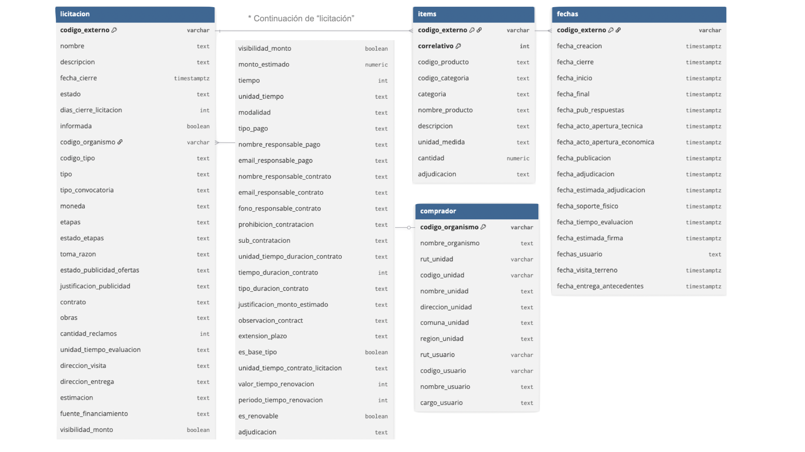
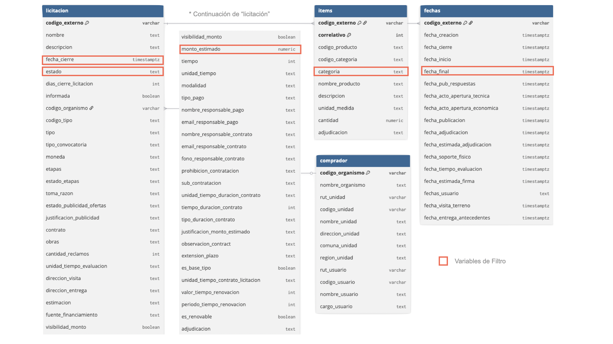
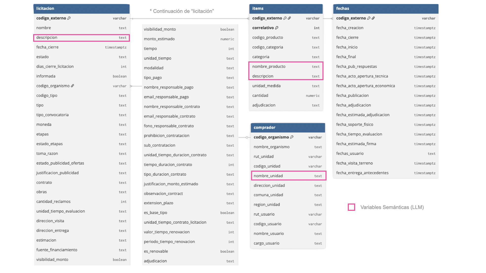
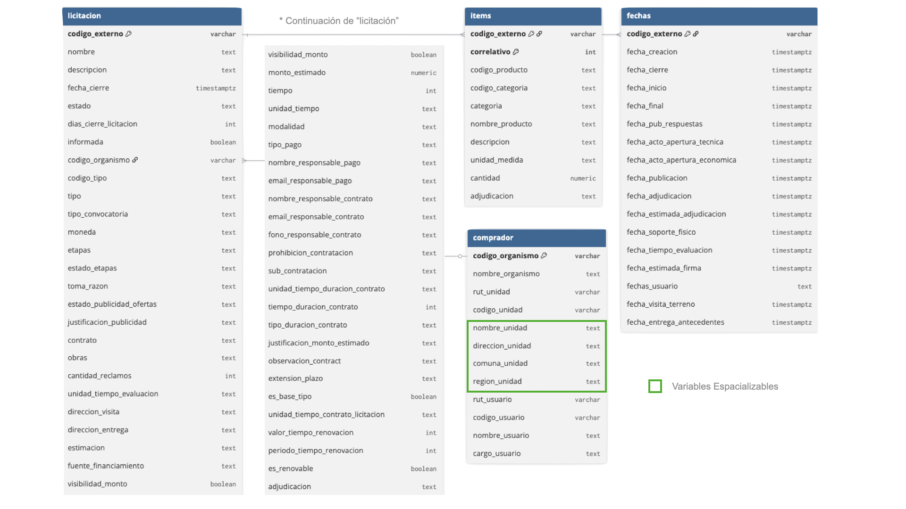

# Ofertas {#sec-ofertas}

En este libro usamos **ofertas** u **ofertas públicas** para referirnos a las licitaciones que publica el Estado: son las oportunidades de negocio que Radar MP busca. Este capítulo explica cómo llegan a la base de datos y qué información se guarda de cada una.

## Cada mañana: la API de Mercado Público

Cada día programado (por defecto, de lunes a viernes a las 08:30) el worker pregunta a la API por las licitaciones publicadas hasta el día anterior que falten. El proceso tiene dos pasos:

1. **Listado.** Una consulta por fecha devuelve los códigos de las licitaciones publicadas, con su nombre, estado y fecha de cierre. Esto toma segundos.
2. **Detalle.** Para cada código se pide la ficha completa: descripción, comprador, monto estimado, fechas y lista de productos. Esto es lo lento.

La API rechaza las consultas si se le pide muy rápido: con un segundo entre consultas falla la mitad de las veces. Por eso el cliente (`backend/src/radar/mp_client/`) espera **dos segundos** entre consultas y, si igual recibe un rechazo, espera cada vez más antes de reintentar, hasta seis veces. Con ~500 licitaciones, un día completo tarda unos **20 minutos**.

### Días incompletos y recuperación

Un día cuenta como **completo** solo si se obtuvo el detalle de todas sus licitaciones sin errores. Si el computador estuvo apagado o la API falló, la siguiente ejecución recupera automáticamente los días pendientes (hasta 14 hacia atrás). Si falta más tiempo, se completa con Datos Abiertos. La pantalla de Operación muestra la cobertura de los últimos 14 días y permite reprocesar cualquier día con un botón.

```bash
uv run radar ingest --date 2026-10-27   # un día específico
uv run radar ingest --catch-up          # todos los días pendientes
```

## Cada mes: Datos Abiertos

El día 3 de cada mes el worker descarga el archivo del mes anterior desde ChileCompra. Es un ZIP de 15 a 35 MB con un CSV donde cada fila combina una licitación, uno de sus productos y una de las ofertas recibidas. Se lee con DuckDB y un mes completo se carga en unos **10 segundos**.

El archivo tiene defectos conocidos que el importador tolera y cuenta: viene en una codificación antigua (cp1252), usa coma decimal, trae montos imposibles y algunas líneas corruptas (849 de 160 mil en marzo de 2026).

### Cómo se combinan las dos fuentes

Cuando una licitación llega por ambas vías, la regla es simple: **la API manda en el contenido, Datos Abiertos manda en el resultado**.

- Si la licitación ya tiene la ficha de la API, el archivo solo rellena los campos vacíos.
- El **estado** siempre se actualiza desde el archivo: así se sabe si terminó adjudicada, desierta o revocada.
- Las **adjudicaciones** solo vienen del archivo y siempre se reemplazan.

## Cómo vienen los datos de Mercado Público

Cada licitación llega como cuatro bloques de información: la **licitación** misma (más de cincuenta campos), sus **ítems** (los productos pedidos), sus **fechas** (publicación, cierre, adjudicación y otras) y el **comprador** (organismo y unidad de compra). La @fig-mp-original muestra esa estructura tal como la entrega la fuente.

::: {.column-page-right .captura}
{#fig-mp-original fig-align="center"}
:::

No todos los campos sirven igual. Radar MP usa tres grupos, marcados en las pestañas siguientes:

::: {.panel-tabset}
### Variables de filtro

Estado, fecha de cierre, monto estimado y categoría de los ítems: permiten descartar o priorizar sin leer el texto.

::: {.column-page-right .captura}
{fig-align="center"}
:::

### Variables semánticas

Descripción de la licitación, nombre y descripción de los productos y nombre de la unidad compradora: es el texto que leen la búsqueda por similitud y los modelos de lenguaje.

::: {.column-page-right .captura}
{fig-align="center"}
:::

### Variables espaciales

Nombre, dirección, comuna y región de la unidad compradora: permiten ubicar la demanda en el territorio.

::: {.column-page-right .captura}
{fig-align="center"}
:::
:::

## Qué se guarda de cada licitación

La tabla `tender` guarda una fila por licitación. Los campos más usados son:

| Campo | Para qué se usa |
|---|---|
| `codigo` | Identificador; enlaza a la ficha en Mercado Público |
| `nombre` y `descripcion` | Lo que leen las reglas, la búsqueda y los modelos |
| `estado` | Saber si sigue abierta o cómo terminó |
| `monto_estimado` | Componente económico del puntaje |
| `fecha_cierre` | Componente de plazo del puntaje y filtro «solo abiertas» |
| `codigo_organismo`, `region` | Quién compra y dónde (ver [Organismos compradores](organismos.qmd)) |
| `first_seen_date` | El día en que apareció; agrupa la bandeja por día |
| `raw` | Copia íntegra de la respuesta de la API, por si se necesita otro dato |

: Campos principales de `tender` {#tbl-tender}

La consultoría de gobernanza de la Subdere quedó guardada así el 27 de octubre: su nombre y descripción completos, la Subdere como comprador, su fecha de cierre y la lista de productos pedidos. Con eso basta para que el matching la evalúe.

::: {.callout-tip}
## En resumen

- La API trae lo nuevo cada mañana; Datos Abiertos trae el histórico y el resultado cada mes.
- Los días incompletos se recuperan solos.
- Saber *qué* se compra no basta: el capítulo siguiente trata de *quién* compra.
:::
