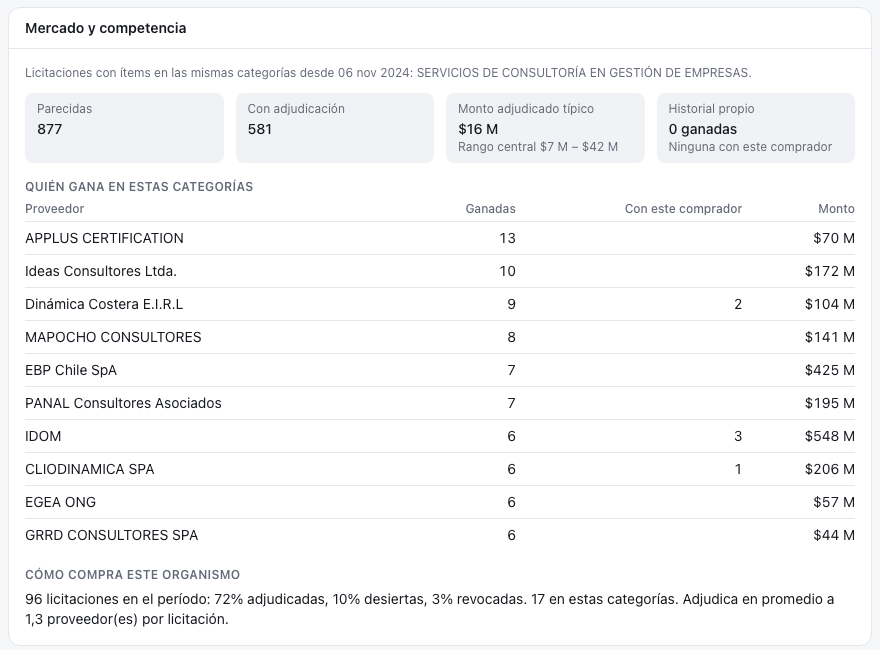

# Organismos compradores {#sec-organismos}

Los **organismos compradores** son las instituciones públicas que publican licitaciones: municipios, gobiernos regionales, ministerios, servicios y empresas del Estado. Son los clientes potenciales de la universidad.

::: {.callout-note}
No confundir con las **unidades UAI** (centros y facultades), que son quienes venden. Ellas se tratan en [Digest: centros y facultades](../digest/unidades.qmd).
:::

## Qué se guarda

Cada organismo tiene una fila en la tabla `buyer` con su código en Mercado Público, su nombre y su **sector** (municipalidades, gobierno central, salud, fuerzas armadas, etc.). Hoy hay **1.152** organismos registrados.

Un organismo grande compra a través de varias **unidades de compra**: distintas divisiones de un ministerio o sus oficinas regionales. Por eso cada licitación guarda también la unidad que la publicó, su comuna y su **región**. La región es uno de los filtros de la bandeja.

## Para qué sirve conocer al comprador

El comprador aporta información en tres momentos.

**Al decidir.** El nombre y el sector del organismo se incluyen en lo que leen los modelos de IA. No es lo mismo un «estudio de diagnóstico» pedido por un gobierno regional que por un hospital.

**Al priorizar y postular.** Antes de postular conviene saber contra quién se compite y cuánto se suele pagar. Para eso Radar MP construye, a partir de un millón de adjudicaciones históricas, una vista de **mercado** que aparece en el detalle de cada licitación.

**Al reconocer clientes propios.** Las adjudicaciones ganadas por la UAI (RUT `71.543.200-5`) muestran con qué organismos la universidad ya ha trabajado.

## La vista de mercado

::: {.captura}
{width="100%"}
:::

La vista toma las categorías de los productos que pide la licitación y busca, en los últimos 24 meses, otras licitaciones de las mismas categorías que ya se adjudicaron. Con eso responde cuatro preguntas:

1. **¿Quién gana en este tema?** Los proveedores que más se adjudican esas categorías, cuántas veces con este mismo comprador, y si son universidades o la propia UAI.
2. **¿Cuánto se paga?** El monto adjudicado típico y su rango. Si una licitación presupuesta $80 millones donde lo típico son $16 millones, su alcance es probablemente mayor de lo habitual.
3. **¿Cómo compra este organismo?** Qué porcentaje de sus licitaciones termina adjudicada, desierta o revocada. Un comprador que declara desierta la mitad de sus licitaciones es un riesgo.
4. **¿Ya trabajamos con él?** El historial propio de la UAI.

La consulta responde en menos de un segundo (`backend/src/radar/market.py`).

### Limitaciones

- Comparar por categoría es una aproximación gruesa: dos «servicios de consultoría» pueden ser muy distintos.
- Las adjudicaciones llegan con un mes de desfase.
- Las universidades se reconocen por el nombre del proveedor.

::: {.callout-tip}
## Por completar

- Una **ficha por organismo** con su historial de compras afines a cada unidad. [pendiente]{.pendiente}
- Clasificar el tipo de organismo (municipio, gobierno regional, ministerio, servicio) para usarlo como señal de prioridad. [pendiente]{.pendiente}
:::

::: {.callout-tip}
## En resumen

- El comprador es contexto para los modelos y para decidir si postular.
- La vista de mercado resume competencia, montos y comportamiento del organismo.
- El capítulo siguiente baja al detalle de *qué productos* pide cada licitación.
:::
