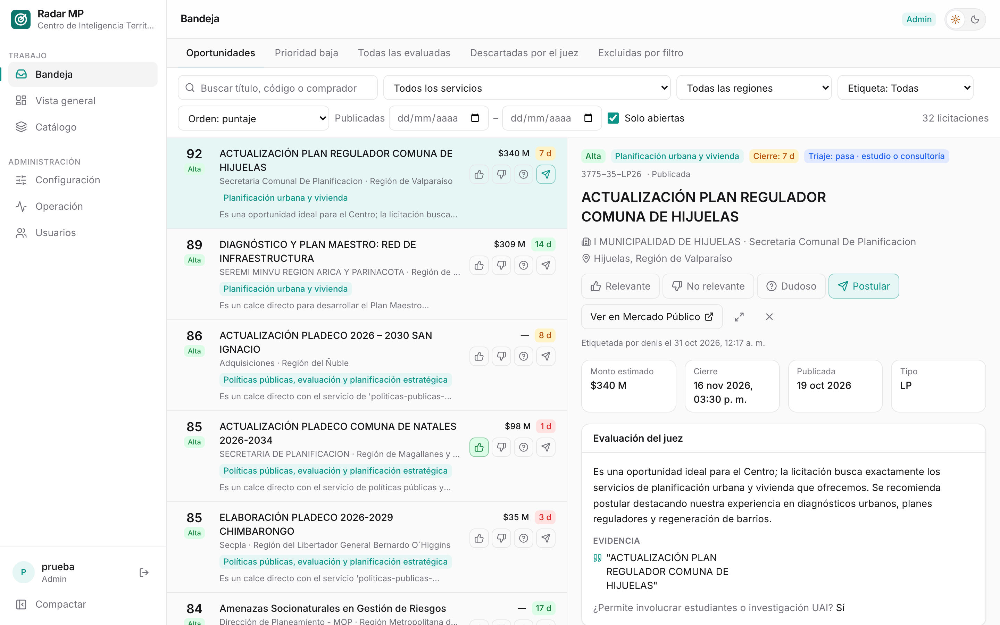
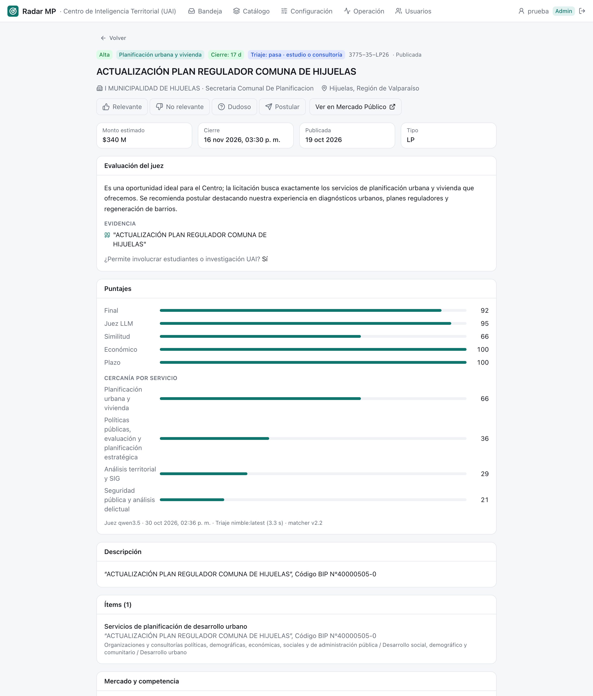

# Bandeja {#sec-bandeja}

La bandeja es la pantalla principal y la única que usa todo el equipo: la lista de oportunidades de la unidad, ordenada por puntaje, con el detalle de cada una al lado. Disponible desde el rol **lectura**; los botones para etiquetar aparecen desde **analista**.

::: {.column-page-right .captura}
{#fig-bandeja width="100%"}
:::

## Qué hay en la pantalla

### Vistas

Las pestañas de arriba eligen qué mirar:

| Vista | Qué muestra | Para qué |
|---|---|---|
| **Oportunidades** | Prioridad alta y media | El trabajo diario |
| **Prioridad baja** | Juzgadas, con puntaje bajo el umbral de media | Revisar de vez en cuando |
| **Todas las evaluadas** | Todo lo que pasó los filtros | Buscar algo puntual |
| **Descartadas por el juez** | El triaje o el juez dijeron que no | Detectar errores del modelo |
| **Excluidas por filtro** | Botadas por una regla de exclusión, con el motivo | Detectar reglas demasiado amplias |

: Vistas de la bandeja {#tbl-vistas}

### Filtros y orden

Debajo de las vistas hay una fila de filtros:

- **Buscar** por título, código o comprador (tecla `/`).
- **Servicio** y **región**.
- **Etiqueta**: todas, sin etiqueta, relevantes, postuladas, no relevantes o dudosas.
- **Orden**: puntaje (por defecto), cierre más próximo, más recientes o monto.
- **Publicadas** entre dos fechas.
- **Solo abiertas**, activado por defecto. Si no hay resultados, la bandeja ofrece incluir las ya cerradas.

Todo queda en la dirección de la página (`?vista=descartadas&servicio=…&sel=…`), así que una vista filtrada, o una licitación seleccionada, se comparte copiando el enlace. La lista muestra 50 licitaciones por página.

### Cada fila

A la izquierda, el **puntaje final** y la prioridad. Al centro, el nombre, el comprador y la región, el **servicio propuesto** y la primera línea del resumen del juez (o el motivo de exclusión). A la derecha, el **monto**, cuántos días faltan para el cierre y, para analista en adelante, los botones de etiqueta.

### El detalle

Al seleccionar una fila se abre el detalle a la derecha, sin salir de la lista; con `Enter` o el ícono ⤢ se abre en página completa (`/l/<código>`). Responde la pregunta «¿por qué esta licitación está aquí?». De arriba hacia abajo:

1. **Encabezado**: prioridad, servicio, cierre, resultado del triaje y su categoría de entregable, código y estado. Los botones de etiqueta, el enlace a Mercado Público y, si ya tiene etiqueta, quién la puso y cuándo.
2. **Datos**: monto estimado, cierre, publicación y tipo de licitación.
3. **Evaluación del juez**: su resumen, la **evidencia** que citó del texto, los **riesgos**, los **casos de referencia** que consultó (con su similitud) y si permite involucrar estudiantes o investigación UAI. Si no fue juzgada, explica por qué: regla de exclusión, triaje o fuera del tope del día.
4. **Puntajes**: el final y sus cuatro componentes (juez, similitud, económico, plazo), y la cercanía con los cuatro servicios más parecidos. Al pie, qué modelos la evaluaron y cuándo.
5. **Descripción** e **ítems**, con la evidencia del juez **resaltada**.
6. **Mercado**: quién gana licitaciones parecidas, montos típicos y comportamiento del comprador ([Organismos compradores](../ingest/organismos.qmd)).
7. **Comprador**: cuántas licitaciones ha publicado, sus proveedores más adjudicados y sus licitaciones recientes.

::: {.captura}
{#fig-detalle width="80%"}
:::

### Teclado

La bandeja se puede recorrer entera sin mouse:

| Tecla | Acción |
|---|---|
| `j` / `↓` | Siguiente licitación |
| `k` / `↑` | Anterior |
| `Enter` | Abrir en página completa |
| `/` | Ir al buscador |
| `Esc` | Cerrar el detalle |
| `1` `2` `3` `p` | Relevante, no relevante, dudoso, postular (analista en adelante) |

: Atajos de teclado {#tbl-teclado}

## Cómo se hace

### Revisar las oportunidades del día

1. Abrir la bandeja en *Oportunidades* (es la vista por defecto).
2. Para ver solo lo nuevo, filtrar *Publicadas* desde ayer, o *Etiqueta: Sin etiqueta*.
3. Seleccionar la primera fila y recorrer con `j`.
4. En cada una, leer el resumen y la evidencia; si hace falta, revisar riesgos y mercado.

### Etiquetar

Desde el rol **analista**, cada licitación se puede marcar con un botón o una tecla:

| Botón | Tecla | Significa |
|---|---|---|
| 👍 Relevante | `1` | Sirve a la unidad |
| 👎 No relevante | `2` | No sirve |
| ? Dudoso | `3` | No está claro; hay que conversarlo |
| ✈ Postular | `p` | Sirve y se decidió preparar una oferta |

: Botones de etiqueta {#tbl-botones}

- Repetir el mismo botón **quita** la etiqueta.
- Hay **una etiqueta vigente por licitación y unidad**: si otra persona marca otra cosa, la última gana.
- La etiqueta queda **atribuida** a quien la puso y se ve en el encabezado del detalle. Los votos de cada persona, y en qué no coinciden, se ven en la [Vista general](vista-general.qmd).
- El clic no cambia el puntaje ni vuelve a juzgar la licitación: sirve desde el día siguiente como caso de referencia para el juez, para calibrar umbrales y para medir aciertos ([El ciclo de retroalimentación](../digest/usuarios.qmd#el-ciclo-de-retroalimentación)).

### Buscar lo que se pudo haber perdido

1. Ir a *Descartadas por el juez* o *Excluidas por filtro*.
2. Quitar *Solo abiertas* si se quiere revisar el pasado.
3. Si aparece algo bueno, marcarlo 👍: es la señal más valiosa. Luego, según el caso, ajustar la regla en [Configuración](configuracion.qmd#reglas-de-exclusión) o el servicio en el [Catálogo](catalogo.qmd).

### Compartir una licitación

Seleccionarla y copiar la dirección del navegador. Quien la abra verá la misma vista y la misma licitación seleccionada, siempre que su rol le dé acceso a la bandeja.

## Bitácora

| Fecha | Cambio | Commit |
|:---|:---|:---|
| 29-oct-2026 | Primera bandeja: vistas por prioridad, filtros guardados en la dirección, panel de detalle y etiquetado con teclado. El detalle muestra la evaluación del juez con evidencia resaltada, los ítems y el historial del comprador. | `ddbfd17` |
| 29-oct-2026 | El detalle muestra los **casos de referencia** que vio el juez y una tarjeta de **mercado** con datos de adjudicaciones. | `751cfab` |
| 30-oct-2026 | Llega el **triaje**: el detalle muestra si pasó y la categoría de entregable; las descartadas explican el motivo. | `1b163ff` |
| 30-oct-2026 | Con inicio de sesión, cada etiqueta queda atribuida a la persona con sesión iniciada, ya no a un nombre escrito a mano. | `6e70353` |
| 30-oct-2026 | Los botones de etiqueta solo aparecen desde **jefatura**; para lectura y analista la bandeja es de consulta. | `263246a` |
| 31-oct-2026 | Los analistas también etiquetan; lectura sigue siendo solo consulta. Abrir el detalle o Mercado Público queda registrado, y cada voto guarda lo que decían el triaje y el juez. | `0c23c23`, `f658574` |

: Bitácora de la Bandeja {#tbl-bitacora-bandeja tbl-colwidths="[14,74,12]"}

::: {.callout-warning}
## Pendiente

- Un campo para comentar el porqué de una etiqueta; hoy los comentarios solo entran por la planilla de evaluación (`radar eval`). [pendiente]{.pendiente}
:::
