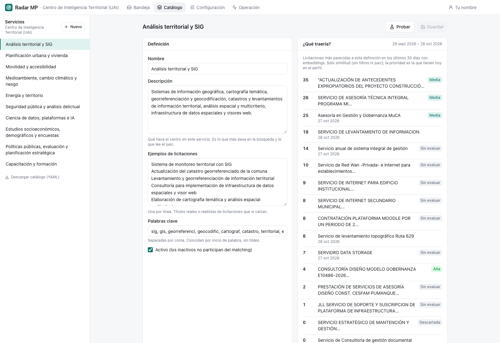

# Catálogo {#sec-catalogo}

El catálogo describe **qué sabe hacer la unidad**: sus servicios. Es la pieza que más influye en lo que llega a la bandeja, porque de cada servicio salen los vectores de la [búsqueda por significado](../matching/embeddings.qmd) y el texto que lee el juez. Disponible desde el rol **analista**.

::: {.captura}
{#fig-catalogo width="100%"}
:::

## Qué hay en la pantalla

**A la izquierda**, la lista de servicios de la unidad. Los inactivos aparecen tachados. Arriba está el botón **Nuevo** y abajo el enlace **Descargar catálogo (YAML)**.

**Al centro**, el servicio seleccionado en dos tarjetas:

- **Definición**: los campos editables.

  | Campo | Qué poner |
  |---|---|
  | Nombre | Cómo lo llama la unidad |
  | Identificador (*slug*) | Se genera del nombre al crear; **no se puede cambiar después** |
  | Descripción | Qué hace el centro en este servicio. Es lo que más pesa en la búsqueda y lo que lee el juez |
  | Ejemplos de licitaciones | Uno por línea: títulos reales o realistas que sí calzan |
  | Palabras clave | Separadas por coma; coinciden por inicio de palabra y sin tildes |
  | Activo | Los inactivos no participan del matching |

  : Campos de un servicio {#tbl-campos-servicio}

- **¿Qué traería?**: las licitaciones de los últimos 30 días más parecidas a la definición, con su cercanía (0 a 100) y la prioridad que tienen hoy. Usa solo los *embeddings*, sin filtros ni juez. Se calcula sola al abrir un servicio y de nuevo con **Probar**. Cada resultado enlaza a la licitación en la bandeja.

Arriba a la derecha están **Probar** y **Guardar**. Guardar se activa solo si hay cambios y los campos obligatorios (nombre, identificador, descripción) están completos.

## Cómo se hace

### Crear un servicio

1. Presionar **Nuevo**.
2. Escribir el nombre; el identificador se completa solo. Si ya existe, la pantalla avisa.
3. Escribir la descripción diciendo **qué se entrega**, no solo el tema: «Estudios de movilidad urbana con encuestas origen-destino y modelos de transporte» es mejor que «Movilidad».
4. Agregar ejemplos **variados**: cada ejemplo es un vector más, así que importa más la variedad que la cantidad.
5. Agregar palabras clave solo para términos técnicos inequívocos (`geoespacial`, `catastr`, `pladeco`); no para palabras generales como «asesoría».
6. Presionar **Probar** y revisar la lista de la derecha. Si trae ruido, acotar la descripción; si falta lo esperado, agregar ejemplos.
7. Presionar **Guardar**. La plataforma calcula los vectores del servicio y muestra «Guardado y vectores recalculados».

### Modificar un servicio

1. Seleccionarlo en la lista y editar.
2. **Probar** para comparar con lo que traía antes.
3. **Guardar**.

El cambio aplica a los días que se procesen desde ese momento. Para aplicarlo a días pasados hay que reprocesarlos con el juez desde [Operación](operacion.qmd#reprocesar), marcando *Volver a juzgar las ya evaluadas*.

### Desactivar un servicio

Los servicios no se borran: se desmarca **Activo** y se guarda. Deja de participar en el matching y aparece tachado, pero las decisiones antiguas que lo mencionan siguen siendo legibles. Se reactiva marcando la casilla otra vez.

### Respaldar el catálogo en el repositorio

Los cambios hechos en la web quedan en la base de datos, no en el archivo `backend/catalogs/cit.yaml`. Para llevarlos al repositorio:

1. Presionar **Descargar catálogo (YAML)** (`/profiles/{id}/catalog.yaml`).
2. Reemplazar el archivo del repositorio y hacer *commit*.

::: {.callout-warning}
## La web y el YAML no se sincronizan solos

Volver a cargar el YAML con `radar catalog load` **sobrescribe** los servicios, reglas y configuración editados en la web (salvo las alertas). Si un servicio ya no está en el YAML, queda inactivo. Conviene descargar primero.
:::

### Crear el perfil de una unidad nueva

Un perfil completo (servicios, reglas y configuración) se crea desde la línea de comandos a partir de un YAML. Lo más simple es copiar el del CIT y adaptarlo:

```yaml
id: cit
nombre: Centro de Inteligencia Territorial (UAI)
descripcion: >
  Qué hace la unidad y, muy importante, qué NO hace
  (bienes, obras, operación…).
config:
  weights: {llm: 0.60, retrieval: 0.15, economico: 0.15, plazo: 0.10}
  prioridad: {alta: 75, media: 55}
  triaje: {activo: true, modelo: nimble:latest, max_juicios: 25}
services:
  - slug: analisis-territorial-sig
    nombre: Análisis territorial y SIG
    descripcion: ...
    ejemplos: [...]
    keywords: [...]
rules:
  exclude_title: [...]
  exclude_unspsc: [...]
```

```bash
uv run radar catalog load catalogs/mi-unidad.yaml
```

Hoy la web trabaja con un solo perfil (`cit`); crear o eliminar perfiles desde la web, y cambiar de unidad en el menú, es parte de [Otros centros](../futuro/otros-centros.qmd). [pendiente]{.pendiente}

## Bitácora

| Fecha | Cambio | Commit |
|:---|:---|:---|
| 28-oct-2026 | Primer catálogo del CIT en `catalogs/cit.yaml`: diez servicios en borrador con descripción, ejemplos y palabras clave, cargados con `radar catalog load`. Cada descripción y ejemplo se convierte en un vector. | `77f0a42` |
| 29-oct-2026 | Pantalla **Catálogo**: crear y editar servicios desde la web con recálculo de vectores, **Probar** contra los últimos 30 días y descarga del YAML. | `ddbfd17` |
| 29-oct-2026 | Volver a cargar el YAML conserva las alertas editadas en la web. | `12887b1` |
| 30-oct-2026 | El Catálogo exige rol **analista**; lectura ya no lo ve en el menú. | `263246a` |

: Bitácora del Catálogo {#tbl-bitacora-catalogo tbl-colwidths="[14,74,12]"}

::: {.callout-warning}
## Pendiente

- Registrar quién cambió un servicio y cuándo; hoy los cambios del catálogo no quedan en el historial. [pendiente]{.pendiente}
:::
