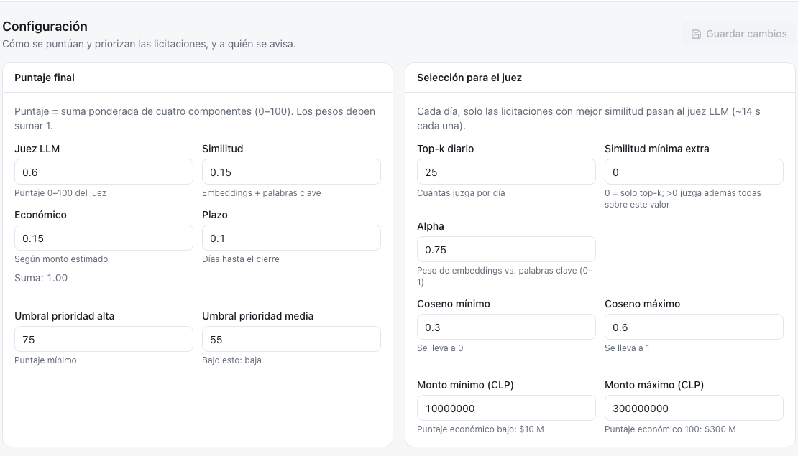
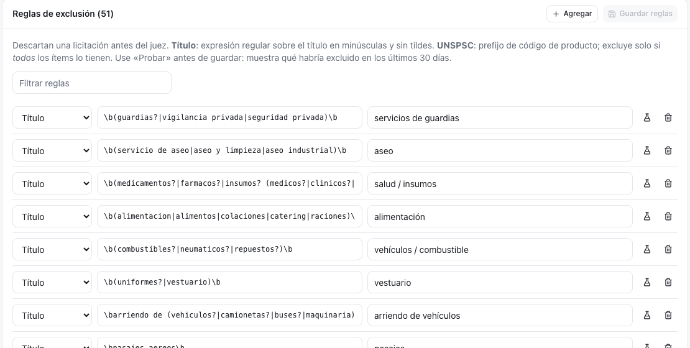
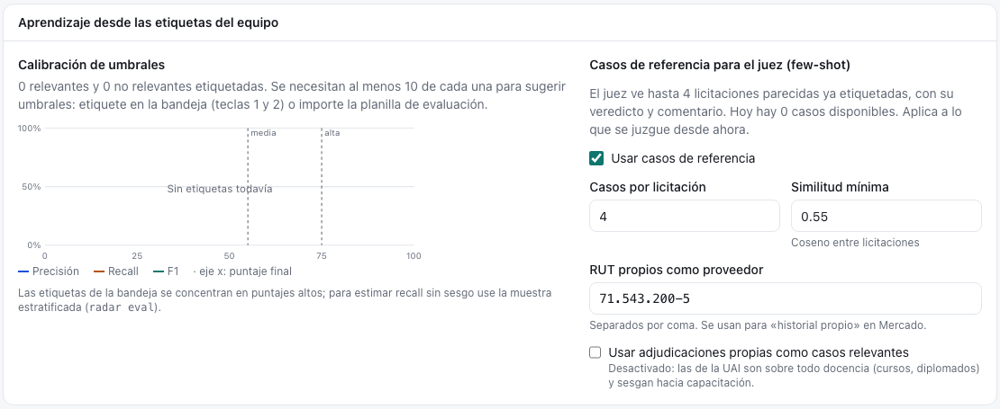

# Configuración {#sec-configuracion}

Configuración reúne los **criterios** de la unidad: cómo se puntúa una licitación, cuántas llegan al juez, cómo aprende de las etiquetas, a quién se avisa y qué se excluye sin mirar. Disponible para el rol **admin**. Es una sola página con seis tarjetas; las cinco primeras se guardan con **Guardar cambios** arriba a la derecha y las reglas tienen su propio botón.

::: {.columns}
::: {.column width="49%"}
::: {.captura}
{#fig-config-puntaje width="100%"}
:::
:::
::: {.column width="2%"}
:::
::: {.column width="49%"}
::: {.captura}
{#fig-config-reglas width="100%"}
:::
:::
:::

## Qué hay en la pantalla

### Puntaje final

Los cuatro pesos del puntaje final y los dos umbrales de prioridad ([Modelos de priorización](../matching/priorizacion.qmd)).

| Campo | Valor del CIT | Qué controla |
|---|---|---|
| Juez LLM | 0,60 | Peso del puntaje 0–100 del juez |
| Similitud | 0,15 | Peso de la cercanía (embeddings + palabras clave) |
| Económico | 0,15 | Peso del monto estimado |
| Plazo | 0,10 | Peso de los días hasta el cierre |
| Umbral prioridad alta | 75 | Puntaje mínimo para alta |
| Umbral prioridad media | 55 | Bajo esto, la licitación es baja |

: Puntaje final {#tbl-config-puntaje}

Los pesos deben sumar 1; si no, **Guardar cambios** queda desactivado.

### Selección para el juez

| Campo | Valor del CIT | Qué controla |
|---|---|---|
| Top-k diario | 25 | Cuántas juzga por día **si el triaje está apagado** |
| Similitud mínima extra | 0 | Con valor > 0, juzga además todas las que lo superen |
| Alpha | 0,75 | Peso del significado frente a las palabras clave |
| Coseno mínimo / máximo | 0,30 / 0,60 | Rango del coseno que se reescala a 0–1 ([Búsqueda por significado](../matching/embeddings.qmd#de-coseno-a-cercanía)) |
| Monto mínimo / máximo | \$10 M / \$300 M | Bajo el mínimo, puntaje económico bajo; sobre el máximo, 100 |

: Selección para el juez {#tbl-config-seleccion}

### Triaje con modelo de decisión

El triaje revisa **todas** las licitaciones recuperadas del día con un modelo pequeño (~1 s cada una) y solo las que pasan van al juez (~13 s) ([Modelos de decisión](../matching/decision.qmd)).

- **Usar triaje antes del juez**: activado en el CIT.
- **Segunda pregunta: tipo de entregable**: descarta capacitación genérica, obras, contratación de personas y operación.
- **Modelo**: `nimble:latest`; vacío usa el `DECISION_MODEL` del servidor.
- **Siempre al juez** (0): las N de mejor similitud se juzgan aunque el triaje diga que no.
- **Tope de juicios** (25 por día): vacío es sin tope.
- **Similitud mínima**: solo se trían las que la superan.
- **Quién postula (en inglés)**: completa la pregunta «*Should … bid on this public tender?*». Va en inglés porque los modelos de decisión se afinaron en ese idioma.

### Aprendizaje

Usa las etiquetas del equipo de dos formas ([El ciclo de retroalimentación](../digest/usuarios.qmd#el-ciclo-de-retroalimentación)).

**Calibración de umbrales.** Muestra cuántas relevantes y no relevantes hay etiquetadas y, con al menos diez de cada una, dibuja la precisión, el recall y el F1 para cada umbral posible, con los umbrales actuales marcados. Sugiere el umbral de **media** con mejor F1 y el de **alta** con precisión ≥ 80 %. **Usar sugerencia** los copia al formulario, pero no se aplican hasta guardar. Abajo indica en qué paso quedaron las relevantes que el sistema no priorizó (regla, triaje, juez, tope).

::: {.captura}
{#fig-config-aprendizaje width="80%"}
:::

**Casos de referencia para el juez.** Activa o desactiva los casos, cuántos ve el juez por licitación (4) y la similitud mínima entre licitaciones (0,55). Aquí también se ingresan los **RUT propios como proveedor**, que alimentan el «historial propio» del mercado, y la opción de usar las adjudicaciones propias como casos relevantes. Esta opción viene apagada: las adjudicaciones de la UAI son sobre todo docencia y sesgarían al juez hacia capacitación.

### Alertas por email

La configuración del **correo con lista fija** de la unidad: si se envía, los destinatarios (uno por línea), las prioridades que se avisan y si solo van las abiertas. **Vista previa** muestra el próximo correo sin marcar nada como enviado. Los correos **personales**, uno por persona, se coordinan en [Operación](operacion.qmd#correos-a-usuarios).

### Reglas de exclusión

Las reglas descartan una licitación **antes** del triaje y del juez. Hay dos tipos:

- **Título**: expresión regular sobre el título en minúsculas y sin tildes, por ejemplo `\b(compra|adquisicion)\b`.
- **UNSPSC**: prefijo de código de producto. Solo excluye si **todos** los ítems lo tienen, y solo mira códigos de 8 dígitos.

Cada regla tiene una **nota**, que es lo que se muestra como motivo en *Excluidas por filtro*. El buscador de arriba filtra la lista.

## Cómo se hace

### Cambiar pesos o umbrales

1. Editar los valores en *Puntaje final*.
2. **Guardar cambios**.
3. En el aviso verde, presionar **Recalcular últimos 14 días (sin LLM)**. Reaplica los puntajes en segundos sin volver a llamar al juez; el avance se ve en [Operación](operacion.qmd).

### Aplicar la calibración sugerida

1. Etiquetar al menos diez relevantes y diez no relevantes en la bandeja.
2. En *Aprendizaje*, revisar la curva y la sugerencia.
3. **Usar sugerencia** → **Guardar cambios** → **Recalcular últimos 14 días**.

### Cambiar el modelo de triaje

1. Descargar el modelo nuevo en Ollama (`ollama pull …`).
2. Escribir su nombre en *Modelo* y guardar.
3. Para días pasados, reprocesar desde la línea de comandos con `radar match --date … --retriage`.

### Agregar una regla de exclusión

1. En *Reglas de exclusión*, presionar **Agregar**.
2. Elegir el tipo, escribir el valor y una nota clara.
3. Presionar el matraz (**Probar en los últimos 30 días**). Muestra cuántas habría excluido, ejemplos y, en rojo, cuáles son hoy oportunidades alta o media.
4. Si no bota nada bueno, **Guardar reglas**.

La regla de oro: excluir solo lo inequívoco. Lo dudoso lo resuelven el triaje y el juez.

### Quitar una regla

Presionar el basurero de la fila y **Guardar reglas**. Las licitaciones que esa regla excluía se vuelven a evaluar al reprocesar los días.

## Bitácora

| Fecha | Cambio | Commit |
|:---|:---|:---|
| 28-oct-2026 | Pesos, umbrales y reglas viven solo en `cit.yaml`; se cambian editando el archivo. | `77f0a42` |
| 29-oct-2026 | Pantalla **Configuración**: pesos, umbrales, selección para el juez y alertas con vista previa, y editor de reglas con **Probar**. | `12887b1` |
| 29-oct-2026 | Tarjeta **Aprendizaje**: curva de calibración, sugerencia de umbrales y casos de referencia para el juez. Las adjudicaciones propias quedan apagadas por defecto. | `751cfab` |
| 30-oct-2026 | Tarjeta **Triaje**: el modelo `nimble` filtra antes del juez. En la referencia de 297 licitaciones: recall 96 % y precisión 52 %, contra 95 % y 35 % del juez solo. | `1b163ff` |
| 30-oct-2026 | Las reglas UNSPSC solo miran códigos de 8 dígitos. Los códigos internos de 9 dígitos del MOP hacían que la regla `10` (plantas y animales) excluyera 111 consultorías, entre ellas un estudio de evaluación de impacto de \$358 M. | `ae4c702` |
| 30-oct-2026 | Nueva regla de título para inspección técnica de obras (AIF, ITO). La precisión del triaje sube a 54 %. | `e780d49` |
| 30-oct-2026 | Configuración exige rol **admin**. | `263246a` |

: Bitácora de Configuración {#tbl-bitacora-config tbl-colwidths="[14,74,12]"}

::: {.callout-warning}
## Pendiente

- Registrar quién cambió un peso, un umbral o una regla, y cuándo. [pendiente]{.pendiente}
:::
