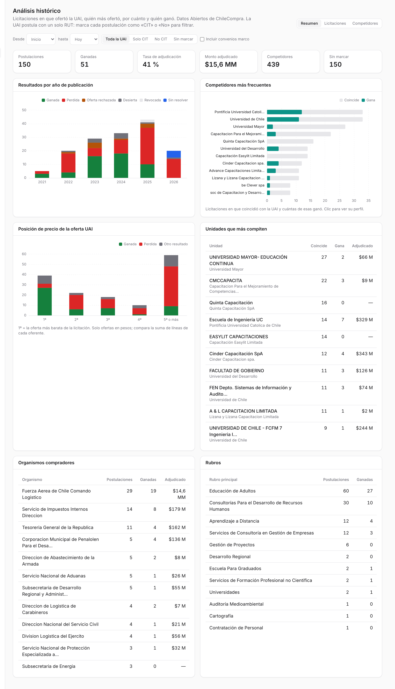
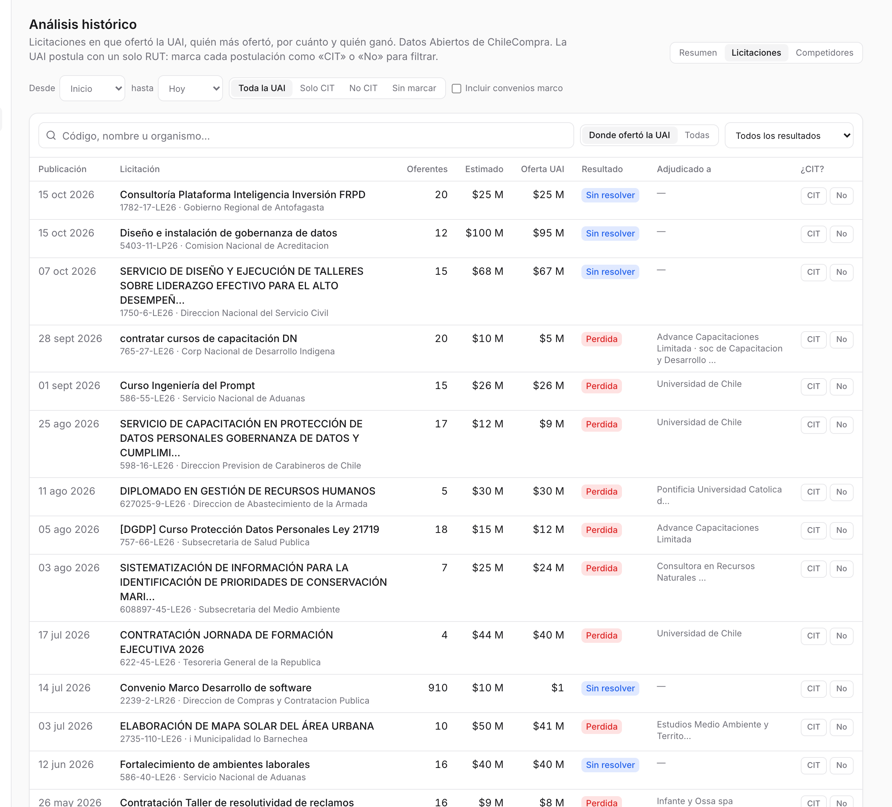
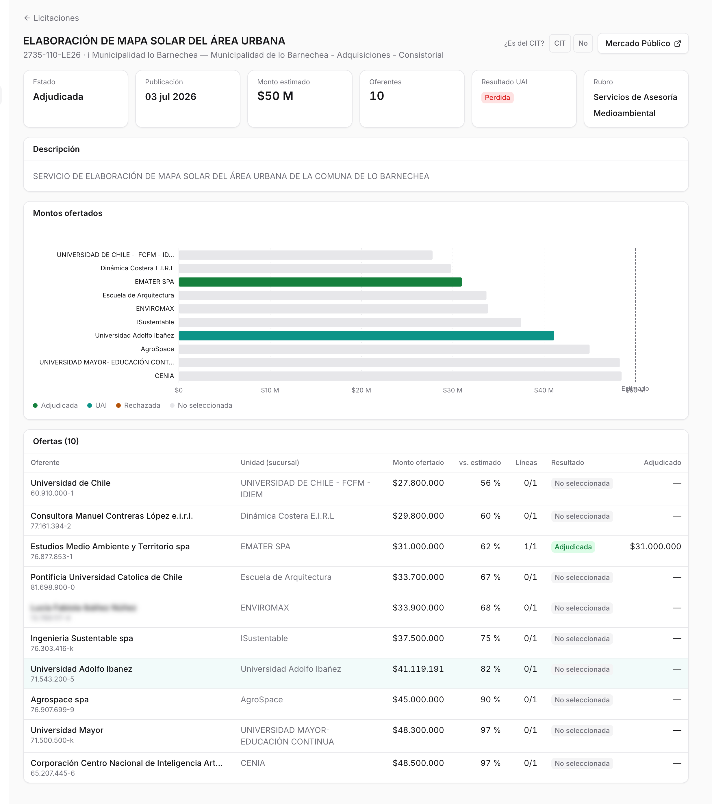
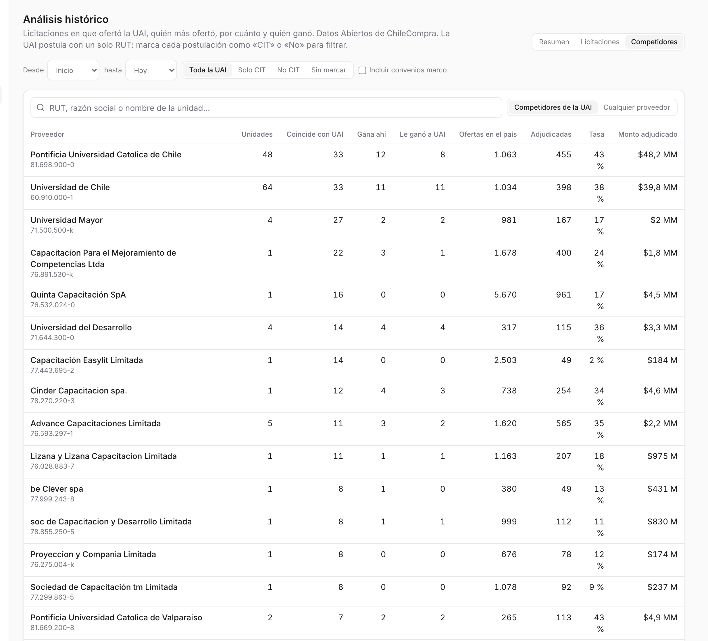
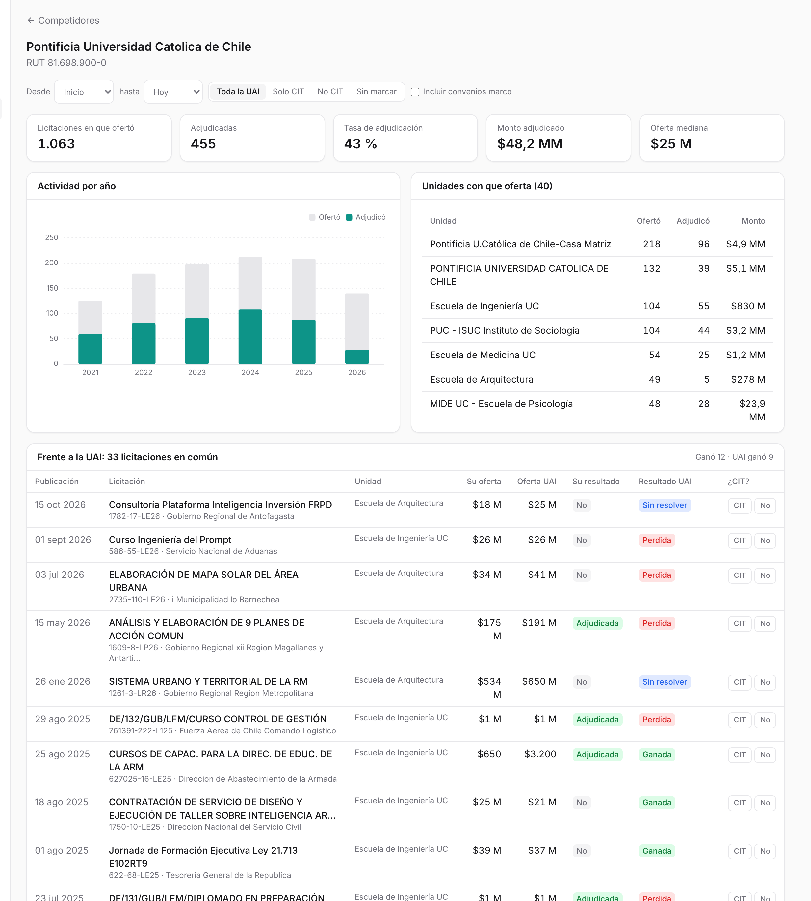

# Análisis histórico {#sec-historico}

El análisis histórico mira hacia atrás: **en qué licitaciones ofertó la UAI, quién más ofertó, por cuánto y quién ganó**. Sirve para conocer a la competencia antes de decidir si postular y a qué precio. Está en **Trabajo**, bajo Catálogo, y lo ven los roles **jefatura**, admin y superadmin.

La bandeja mira lo que se puede postular hoy. Esta pantalla mira lo que ya se resolvió. Todo sale de los Datos Abiertos de ChileCompra, sin modelos de lenguaje.

::: {.column-page-right .captura}
{#fig-historico-resumen width="100%"}
:::

## Qué hay en la pantalla

### Filtros comunes

Arriba hay tres pestañas (**Resumen**, **Licitaciones** y **Competidores**) y una fila de filtros que se aplica a las tres:

- **Desde** y **hasta**: años de publicación, de 2021 en adelante.
- **Marca CIT**: *Toda la UAI*, *Solo CIT*, *No CIT* o *Sin marcar*. La UAI postula con un solo RUT, así que la plataforma no sabe qué postulaciones son del CIT y cuáles de otras unidades. Alguien tiene que marcarlas ([Marcar una postulación como del CIT](#marcar-una-postulación-como-del-cit)).
- **Incluir convenios marco**: por defecto se dejan fuera las licitaciones con más de 100 oferentes, como los convenios marco, porque distorsionan los indicadores de competencia.

Los montos se suman solo en pesos. Los que vienen en otra moneda se muestran, pero no se suman.

### Resumen

Indicadores de las postulaciones de la UAI:

| Indicador | Qué muestra |
|---|---|
| Postulaciones | Licitaciones en que ofertó el RUT de la UAI |
| Ganadas | Al pasar el mouse: perdidas, rechazadas, desiertas y sin resolver |
| Tasa de adjudicación | Ganadas / (ganadas + perdidas) |
| Monto adjudicado | Suma de lo adjudicado a la UAI |
| Competidores | RUT distintos que ofertaron en las mismas licitaciones |
| Sin marcar | Postulaciones que todavía no se han marcado como CIT o no |

: Indicadores del análisis histórico {#tbl-historico-kpis}

Debajo, seis tarjetas:

- **Resultados por año de publicación**: ganadas, perdidas, ofertas rechazadas, desiertas, revocadas y sin resolver.
- **Competidores más frecuentes**: en cuántas licitaciones coincidió cada uno con la UAI y cuántas de esas ganó. Un clic abre su perfil.
- **Posición de precio de la oferta UAI**: cuántas veces la oferta de la UAI fue la 1ª más barata, la 2ª, la 3ª, la 4ª o la 5ª o más, y con qué resultado. Compara la suma de las líneas de cada oferente.
- **Unidades que más compiten**: lo mismo, pero por sucursal (por ejemplo, «Escuela de Ingeniería UC» en vez de «Pontificia Universidad Católica»).
- **Organismos compradores** y **rubros** donde postula la UAI, con cuántas ganó.

### Licitaciones

::: {.captura}
{#fig-historico-licitaciones width="100%"}
:::

Un buscador por código, nombre u organismo y dos selectores. El primero elige el **ámbito**: *Donde ofertó la UAI* o *Todas* las licitaciones del país. El segundo filtra por **resultado**. La tabla muestra fecha de publicación, licitación, número de oferentes, monto estimado, oferta de la UAI, resultado, a quién se adjudicó y los botones **CIT / No**.

Al abrir una licitación se ve su **ficha**:

::: {.captura}
{#fig-historico-licitacion width="100%"}
:::

- Estado, publicación, monto estimado, número de oferentes, resultado de la UAI y rubro.
- **Montos ofertados**: una barra por oferente, con la adjudicada en verde, la UAI destacada y una línea en el monto estimado.
- **Ofertas**: cada oferente con su unidad, monto ofertado, porcentaje frente al estimado, líneas adjudicadas sobre ofertadas, resultado y monto adjudicado.
- Arriba a la derecha, la marca **¿Es del CIT?** y el enlace a Mercado Público.

En el ejemplo de la @fig-historico-licitacion, *Elaboración de mapa solar del área urbana* de Lo Barnechea, la UAI ofertó el 82 % del estimado y quedó séptima de diez en precio. Ganó una consultora ambiental con el 62 %.

### Competidores

::: {.captura}
{#fig-historico-competidores width="100%"}
:::

Un buscador por RUT, razón social o nombre de unidad, con dos ámbitos. *Competidores de la UAI* son los proveedores que coincidieron con ella al menos una vez. *Cualquier proveedor* busca en todo el país y pide al menos tres caracteres. La tabla muestra cuántas unidades tiene cada proveedor, en cuántas licitaciones coincidió con la UAI, cuántas de esas ganó, cuántas veces le ganó a la UAI y su actividad en todo el país: ofertas, adjudicaciones, tasa y monto adjudicado.

Al abrir un proveedor se ve su **perfil**:

::: {.captura}
{#fig-historico-competidor width="100%"}
:::

- Licitaciones en que ofertó, adjudicadas, tasa, monto adjudicado y oferta mediana.
- **Actividad por año** y **unidades con que oferta**.
- **Frente a la UAI**: las licitaciones en común, con la oferta de cada uno y sus resultados. Arriba se lee quién ganó más veces.

## Cómo se hace

### Conocer a la competencia antes de postular

1. Ir a **Competidores** y buscar al proveedor que suele aparecer en ese tipo de licitación.
2. En su perfil, revisar con qué unidad oferta, su oferta mediana y cómo le ha ido frente a la UAI.
3. Abrir las licitaciones en común para ver por cuánto ganó.

### Revisar si la UAI compite bien en precio

1. En **Resumen**, mirar *Posición de precio de la oferta UAI*.
2. Si muchas ofertas quedan en 5ª o más y se pierden, el precio puede ser un problema. Si se pierde siendo la más barata, probablemente pesó la evaluación técnica.

### Marcar una postulación como del CIT

1. En **Licitaciones**, dejar *Donde ofertó la UAI* y, si se quiere ir rápido, filtrar *Sin marcar*.
2. Presionar **CIT** o **No** en cada fila, o en la ficha de la licitación.
3. Un clic sobre la opción ya marcada la borra.

Con las postulaciones marcadas, el filtro *Solo CIT* muestra los indicadores del centro en vez de los de toda la UAI.

### Buscar una licitación o un proveedor cualquiera

En **Licitaciones**, elegir el ámbito *Todas*; en **Competidores**, *Cualquier proveedor*. Ambos buscan en todas las licitaciones cargadas, haya ofertado o no la UAI.

## De dónde salen los datos

Los archivos mensuales de Datos Abiertos traen una fila por licitación, ítem y oferta ([Ofertas](../ingest/ofertas.qmd)). La carga mensual (`radar opendata`) ahora guarda también las **ofertas**, agregadas:

| Tabla | Contenido |
|---|---|
| `tender_bid` | Una fila por licitación, RUT y sucursal: líneas ofertadas y adjudicadas, monto ofertado y adjudicado, moneda, si fue rechazada y fecha de envío |
| `supplier` | RUT y razón social |
| `supplier_branch` | Código de sucursal, su RUT y el nombre de la unidad |
| `own_bid_mark` | Por perfil y licitación: si es del CIT, quién lo marcó y cuándo |
| `tender.n_oferentes` | Cuántos RUT distintos ofertaron |

: Tablas del análisis histórico {#tbl-historico-datos}

Un mismo RUT puede ofertar con varias **sucursales**: la Universidad de Chile lo hace con FCFM, FEN y otras. Por eso la pantalla distingue proveedor (RUT) y unidad (sucursal). El detalle por línea no se guarda, porque las líneas adjudicadas ya están en `tender_award`.

Para tener historia se cargan los meses de enero de 2021 a octubre de 2026: 70 archivos. Con ellos, la UAI aparece en **150 postulaciones**, de las cuales ganó 51 (41 % de adjudicación) por \$15.600 millones, frente a 439 competidores distintos.

::: {.callout-note}
## Personas naturales

Algunos oferentes son personas naturales, con su nombre y RUT. En las capturas de este libro esas celdas aparecen desenfocadas.
:::

## Bitácora

| Fecha | Cambio | Commit |
|:---|:---|:---|
| 11-nov-2026 | Pantalla **Análisis histórico**, para jefatura, admin y superadmin (permiso nuevo `historico`): Resumen, Licitaciones y Competidores, con la marca manual «es del CIT». La carga de Datos Abiertos guarda las ofertas de todo el país y se cargan 70 meses (2021-01 a 2026-10). Lleva a la web lo que se había probado en planillas Excel. | en desarrollo, sin *commit* |
| 11-nov-2026 | Primera lectura: 150 postulaciones de la UAI, 51 ganadas (41 %), \$15.600 millones adjudicados y 439 competidores. Los más frecuentes son la PUC y la Universidad de Chile, con 33 licitaciones en común cada una. Ninguna postulación está marcada todavía como del CIT. | — |

: Bitácora del Análisis histórico {#tbl-bitacora-historico tbl-colwidths="[14,74,12]"}

::: {.callout-warning}
## Pendiente

- Marcar qué postulaciones de la UAI son del CIT. [pendiente]{.pendiente}
- Desplegar la pantalla en el servidor `gpu-box` y cargar allá los 70 meses. [pendiente]{.pendiente}
- Volver a importar los últimos meses en cada carga mensual, para captar adjudicaciones tardías. [pendiente]{.pendiente}
- Exportar a Excel desde la pantalla. [pendiente]{.pendiente}
- Sumar Compra Ágil, trato directo y actas de adjudicación. [pendiente]{.pendiente}
:::
