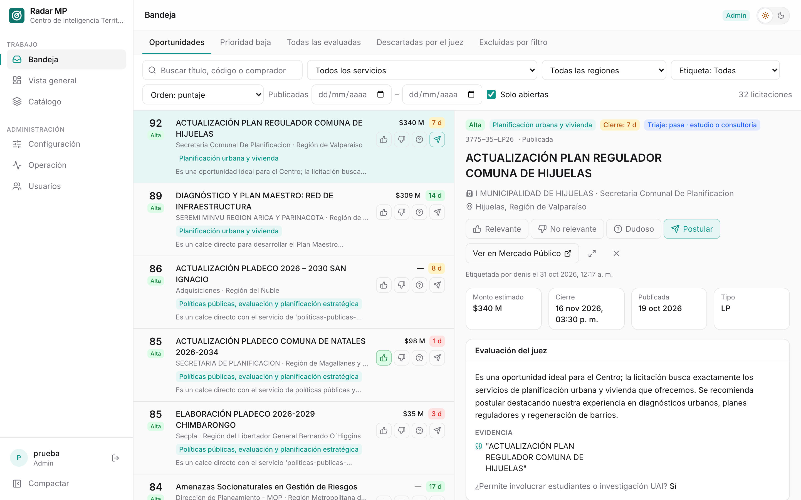

# Plataforma {.unnumbered}

Esta parte es el **manual de la web** de Radar MP y, a la vez, su **bitácora**. Tiene un capítulo por cada sección del menú, en el mismo orden en que aparecen en la barra lateral:

| Capítulo | Para qué sirve | Rol mínimo |
|---|---|---|
| [Bandeja](bandeja.qmd) | Revisar oportunidades, entender por qué llegaron y etiquetarlas | Lectura (etiquetar: analista) |
| [Vista general](vista-general.qmd) | Ver cómo vota el equipo: consenso, montos, plazos y acuerdo con el juez | Lectura |
| [Catálogo](catalogo.qmd) | Describir y probar los servicios de la unidad | Analista |
| [Configuración](configuracion.qmd) | Ajustar puntaje, triaje, aprendizaje, alertas y reglas | Admin |
| [Operación](operacion.qmd) | Ver que todo funcione, reprocesar días, programar la rutina y enviar correos | Admin |
| [Usuarios](usuarios.qmd) | Crear cuentas, asignar roles y revisar la actividad | Admin |

: Secciones de la web {#tbl-secciones}

Cada persona ve en el menú solo las secciones que su rol permite ([Usuarios](usuarios.qmd)).

## Cómo moverse por la web

::: {.column-page-right .captura}
{#fig-navegacion width="100%"}
:::

- **Barra lateral.** A la izquierda, las secciones en dos grupos: **Trabajo** (Bandeja, Vista general, Catálogo) y **Administración** (Configuración, Operación, Usuarios). Al pie están la persona con sesión iniciada, su rol y el botón para cerrar sesión. **Compactar** deja solo los íconos; en pantallas angostas la barra se muestra compacta.
- **Encabezado.** Arriba, el nombre de la sección, el rol de quien mira y el interruptor de tema.
- **Tema claro u oscuro.** El interruptor ☀/☾ cambia el tema. Sin elegir, la web sigue el tema del sistema; la elección se recuerda en cada navegador. Las capturas de este libro están en tema claro.

## Cómo leer cada capítulo

Todos los capítulos siguen el mismo orden:

1. **Qué hay en la pantalla**: una captura y la descripción de cada parte.
2. **Cómo se hace**: tareas concretas paso a paso («crear un servicio», «completar un día que falta»).
3. **Bitácora**: qué cambió en esa sección, con fecha y el *commit* que lo introdujo. Sirve para saber desde cuándo existe algo y por qué se decidió así.

Las tareas que todavía no se pueden hacer se marcan [pendiente]{.pendiente}.

## La rutina en una página

| Cuándo | Quién | Qué | Dónde |
|---|---|---|---|
| Cada mañana, solo | La plataforma | Descarga lo del día anterior, lo analiza y envía los correos | [Operación](operacion.qmd#programación-automática) |
| Cada mañana | Todo el equipo | Lee el correo o revisa *Oportunidades* (5 a 10 licitaciones) | [Bandeja](bandeja.qmd) |
| Cada mañana | Analista o jefatura | Etiqueta lo revisado: `1`, `2`, `3` o `p` | [Bandeja](bandeja.qmd#etiquetar) |
| Semanal | Admin | Revisa que no falten días | [Operación](operacion.qmd#cobertura) |
| Semanal | Jefatura | Revisa los desacuerdos y los plazos de lo postulado | [Vista general](vista-general.qmd) |
| Semanal | Jefatura | Mira *Descartadas* y *Excluidas* por si se perdió algo | [Bandeja](bandeja.qmd#vistas) |
| Mensual | Analista | Ajusta los servicios que traen ruido | [Catálogo](catalogo.qmd) |
| Con ≥ 10 etiquetas por clase | Admin | Revisa la calibración de umbrales | [Configuración](configuracion.qmd#aprendizaje) |
| Trimestral | Admin | Reporte de evaluación con `radar eval report` | Línea de comandos |

: Rutina del equipo {#tbl-rutina}

::: {.callout-important}
## Etiquetar es parte del trabajo

Sin etiquetas no hay forma de saber si la plataforma acierta, ni de calibrar umbrales, ni de mostrarle al juez el criterio del equipo ([El ciclo de retroalimentación](../digest/usuarios.qmd#el-ciclo-de-retroalimentación)).
:::

## Dónde corre

La web corre en el computador del centro: en `http://localhost:5173` durante el desarrollo o en `http://localhost:8080` si se levanta con Docker. Detrás hay una API documentada en `http://localhost:8000/docs`, que aplica los mismos permisos que la web. Cómo instalarla y levantarla se explica en [Operación](operacion.qmd#puesta-en-marcha).

## Bitácora general

Esta tabla resume los hitos; el detalle está en la bitácora de cada capítulo.

| Fecha | Hito |
|---|---|
| 28-oct-2026 | Backend, ingesta programada y matching con modelos locales (sin web todavía) |
| 29-oct-2026 | Primera web: Bandeja, Detalle y Catálogo; luego Configuración y Operación; casos de referencia, calibración y mercado |
| 30-oct-2026 | Triaje con modelo de decisión; base de usuarios, inicio de sesión y cinco roles; correos personales y programación de la rutina desde Operación |
| 31-oct-2026 | Los analistas también etiquetan; nueva pantalla Vista general con el consenso del equipo |
| 03-nov-2026 | Operación muestra el avance de una ingesta mientras corre |
| 04-nov-2026 | Nueva interfaz: barra lateral agrupada en Trabajo y Administración, e interruptor de tema claro/oscuro |
| 09-nov-2026 | Versión 1: empaquetado para correr en un servidor (`gpu-box`) y web endurecida para exponerla en Internet |

: Hitos de la plataforma {#tbl-hitos}
