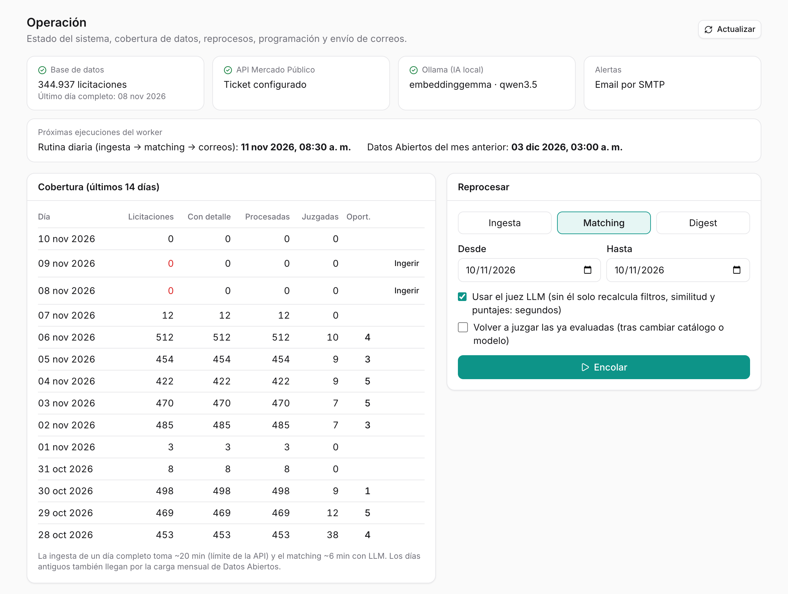
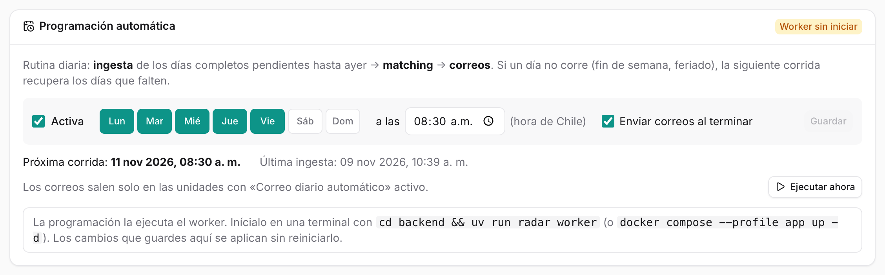
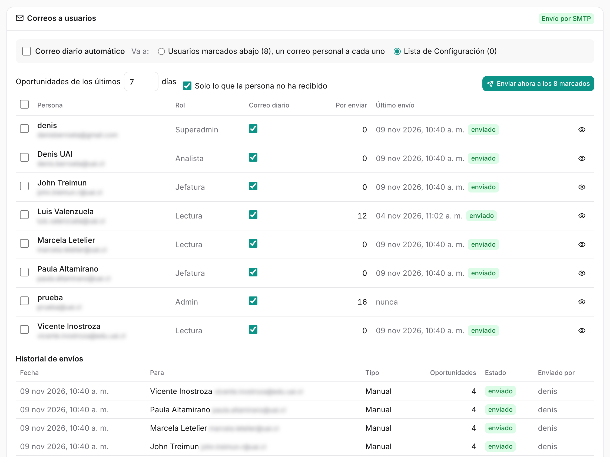
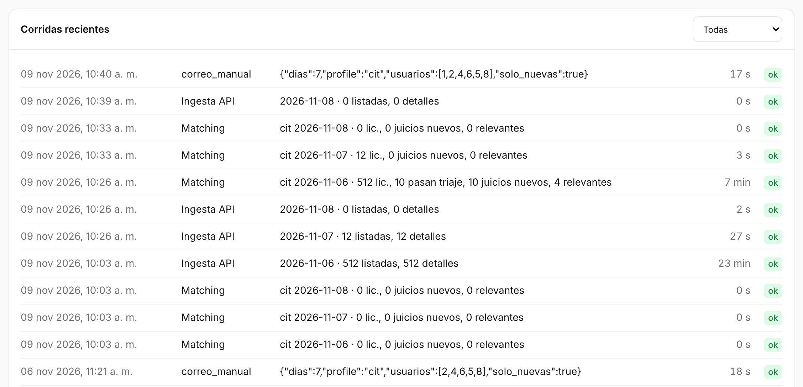

# Operación {#sec-operacion}

Operación es la sala de máquinas: muestra si todo funciona, qué días están completos, qué se está ejecutando, cuándo corre sola la rutina diaria y a quién le llegan los correos. Disponible para el rol **admin**. Es una sola página, de arriba hacia abajo; el botón **Actualizar** vuelve a consultar el estado.

::: {.column-page-right .captura}
{#fig-operacion width="100%"}
:::

## Qué hay en la pantalla

### Estado

Cuatro tarjetas con un ✓ verde o una ✗ roja, y debajo una franja con las próximas ejecuciones del worker. La tarjeta de base de datos muestra además cuántas licitaciones hay guardadas (342.073 al 30 de octubre) y el último día completo.

| Tarjeta | Qué revisa | Si falla |
|---|---|---|
| Base de datos | Conexión a PostgreSQL | `docker compose up -d db` |
| API Mercado Público | Que exista el ticket | Completar `MERCADO_PUBLICO_TICKET` en `.env` |
| Ollama (IA local) | Que Ollama responda y estén los modelos | Abrir Ollama; `ollama pull …` |
| Alertas | Canal de correo | Sin SMTP ni API de correo, los correos se guardan como `.eml` |
| Próximas ejecuciones (franja) | Cuándo corre la rutina diaria y la carga de Datos Abiertos | Ver [Programación automática](#programación-automática) |

: Tarjetas de estado {#tbl-estado}

### Cobertura

La tabla de los **últimos 14 días** muestra, para cada día: licitaciones descargadas, cuántas tienen ficha completa (*con detalle*), cuántas se procesaron, cuántas juzgó el juez y cuántas oportunidades resultaron. Lo incompleto se pinta en naranja o rojo, y al lado aparece el botón para arreglarlo:

- **Ingerir**, si el día no tiene licitaciones o le faltan fichas.
- **Matching**, si están descargadas pero no procesadas.

El día de hoy nunca se marca como incompleto, porque todavía no termina.

### Reprocesar

Un formulario para ejecutar a mano cualquiera de las tres etapas:

| Tipo | Opciones |
|---|---|
| **Ingesta** | Rango de fechas; *Volver a descargar detalles ya guardados* |
| **Matching** | Rango de fechas; *Usar el juez LLM* (sin él solo recalcula filtros, similitud y puntajes, en segundos); *Volver a juzgar las ya evaluadas* (tras cambiar el catálogo o el modelo) |
| **Digest** | *Enviar aunque las alertas estén desactivadas* |

: Opciones de reproceso {#tbl-reproceso}

**Encolar** lo agrega a la **cola**, que aparece debajo con el estado de cada trabajo (en cola, corriendo, ok o error). Los trabajos se ejecutan de a uno y usan exactamente el mismo código que la rutina automática.

### Programación automática

::: {.captura}
{#fig-programacion width="100%"}
:::

Define **qué días y a qué hora** corre sola la rutina diaria: ingesta de los días completos pendientes hasta ayer → matching → correos. Si un día no corre (fin de semana, feriado), la siguiente corrida recupera los días que falten, hasta 14.

- **Activa**, los **días de la semana** y la **hora** (de Chile). Por defecto, de lunes a viernes a las 08:30.
- **Enviar correos al terminar**: los correos salen solo en las unidades con *Correo diario automático* activo.
- **Próxima corrida** y **última ingesta**.
- **Ejecutar ahora**: pone la rutina completa en la cola.
- Arriba a la derecha, si el **worker** está activo, detenido (desde cuándo) o sin iniciar. Los cambios se aplican sin reiniciarlo.

Además del trabajo diario, el worker carga el día 3 de cada mes los Datos Abiertos del mes anterior ([Ingest](../ingest/index.qmd)).

### Correos a usuarios

::: {.captura}
{#fig-correos-usuarios width="100%"}
:::

Coordina el **correo personal**: cada persona recibe su propio correo, sin las licitaciones que ya recibió.

- **Correo diario automático**: si sale con la rutina. **Va a**: los usuarios marcados abajo (un correo personal a cada uno) o la lista fija de [Configuración](configuracion.qmd#alertas-por-email).
- La tabla de **personas** de la unidad: rol, la casilla **Correo diario**, cuántas oportunidades **por enviar** tiene, su **último envío** con su estado y el ojo para ver la **vista previa** de su correo. Las personas dadas de baja aparecen atenuadas.
- **Oportunidades de los últimos N días** y **Solo lo que la persona no ha recibido**: definen qué entra en un envío manual.
- **Enviar ahora**: a los seleccionados o, si no hay selección, a los marcados. Pide confirmación y advierte si no hay canal configurado.
- **Historial de envíos**: fecha, destinatario, tipo (manual o automático), cuántas oportunidades, estado (*enviado* o *guardado .eml*) y quién lo envió.

Un correo guardado como `.eml` no llegó a nadie, así que no cuenta como recibido: la persona lo volverá a recibir cuando haya canal.

### Corridas recientes

::: {.captura}
{#fig-corridas width="100%"}
:::

El historial de ejecuciones (ingesta, Datos Abiertos, matching, digest) con su estado, duración, estadísticas y el error si lo hubo. Se guarda en la tabla `ingest_run`.

Una ingesta de un día hábil toma unos 20 minutos, porque pide la ficha de cada licitación por separado. Mientras corre, su fila muestra el avance: primero «pidiendo listado…» y luego cuántas listó y cuántas fichas lleva, con una estimación de lo que falta (por ejemplo, «detalles 246/498 (~10 min)») y el tiempo transcurrido.

## Cómo funciona la operación automática

```{=html}
<div class="column-page-right diagrama-wrap">
<iframe class="diagrama" src="../diagramas/07-operacion.html?theme=light&embed=1"></iframe>
<a class="diagrama-link" href="../diagramas/07-operacion.html" target="_blank">abrir diagrama interactivo ↗</a>
</div>
```

La operación tolera fallas parciales: si los modelos de IA no responden, el matching se marca con error pero las licitaciones descargadas quedan guardadas, y basta reprocesar el día cuando el problema se resuelve.

## Cómo se hace

### Completar un día que falta

1. En *Cobertura*, buscar el día en rojo o naranja.
2. Presionar **Ingerir** o **Matching** en su fila.
3. Seguir el avance en la cola y, al terminar, en *Corridas recientes*.

Desde la línea de comandos:

```bash
uv run radar ingest --date 2026-10-20 --until 2026-10-24   # completar días faltantes
```

### Volver a juzgar después de cambiar el catálogo

1. En *Reprocesar*, elegir **Matching** y el rango de fechas.
2. Marcar *Usar el juez LLM* y *Volver a juzgar las ya evaluadas*.
3. **Encolar**. Cada licitación juzgada toma unos 13 segundos.

```bash
uv run radar match --date 2026-10-28 --rejudge    # volver a juzgar
uv run radar match --date 2026-10-28 --retriage   # volver a triar con otro modelo
```

### Cambiar el horario de la rutina

1. En *Programación automática*, elegir los días y la hora.
2. **Guardar**. La próxima corrida se actualiza sin reiniciar el worker.

### Activar el correo personal

1. Configurar un canal de envío en `.env`: `SMTP_*`, o una API de correo por HTTPS (`MAIL_PROVIDER` = Brevo o Resend, y `MAIL_API_KEY`) si la red bloquea SMTP.
2. Crear las personas en [Usuarios](usuarios.qmd).
3. En *Correos a usuarios*, marcar **Correo diario** para cada una y revisar su vista previa con el ojo.
4. Elegir **Va a: usuarios marcados** y activar **Correo diario automático**.
5. En *Programación automática*, dejar activo **Enviar correos al terminar**.

### Si algo falla

| Síntoma | Causa probable | Solución |
|---|---|---|
| «No se pudo cargar la bandeja» | La API no está corriendo | `cd backend && uv run radar serve` |
| Error de conexión a `localhost:5432` | Docker o la base de datos apagados | `docker compose up -d db` |
| «Modelo de embeddings no disponible» | Ollama apagado o falta un modelo | Abrir Ollama; `ollama pull embeddinggemma` |
| Muchos rechazos (429) al descargar | Límite de la API de Mercado Público | Aumentar `MP_MIN_INTERVAL_S` en `.env` |
| La API falla tras actualizar el código | Faltan cambios en la base de datos | `cd backend && uv run alembic upgrade head` |
| «Worker sin iniciar» o «detenido» | El proceso del worker no corre | `cd backend && uv run radar worker` |
| Correos «guardado .eml» | No hay canal de envío | Configurar `SMTP_*` o `MAIL_PROVIDER` |

: Problemas comunes {#tbl-problemas}

El script `scripts/estado.sh` muestra qué componentes están funcionando.

## Puesta en marcha

### Requisitos

- Docker Desktop, para la base de datos.
- `uv` (Python 3.13) y Node 22 o superior.
- Ollama instalado en macOS (no en Docker, para que use la GPU) con los modelos `embeddinggemma`, `qwen3.5` y `nimble:latest`.
- Un ticket de acceso a la API de Mercado Público.

### Primera vez

```bash
cp .env.example .env                 # completar MERCADO_PUBLICO_TICKET y el canal de correo
docker compose up -d db
cd backend && uv sync
uv run alembic upgrade head
uv run radar catalog load catalogs/cit.yaml
uv run radar users add ana@uai.cl --username ana --password --superadmin
cd ../frontend && npm install
```

### Cada día

Cada proceso en su propia terminal, desde la raíz del repositorio:

```bash
docker compose up -d db                  # base de datos
open -a Ollama                           # modelos de IA
cd backend && uv run radar serve         # API
cd frontend && npm run dev               # web
cd backend && uv run radar worker        # tareas programadas
```

También se puede levantar todo con `docker compose --profile app up -d --build` (Ollama sigue fuera de Docker).

**¿Necesita internet?** Solo para descargar licitaciones, enviar correos e instalar. Los modelos, la bandeja y el análisis funcionan sin conexión.

## Bitácora

| Fecha | Cambio | Commit |
|:---|:---|:---|
| 28-oct-2026 | **Worker** con APScheduler: recuperación diaria a las 06:00 (hasta 14 días pendientes) y Datos Abiertos el día 3 de cada mes. Perfil `app` de Docker Compose. | `e5fbcaa` |
| 28-oct-2026 | El worker ejecuta el matching después de la ingesta diaria. | `77f0a42` |
| 29-oct-2026 | Pantalla **Operación**: estado, cobertura con arreglos rápidos, formulario de reproceso, cola y corridas recientes. El matching y el correo quedan registrados en `ingest_run`. | `12887b1` |
| 30-oct-2026 | Operación exige rol **admin**. | `263246a` |
| 30-oct-2026 | Tarjeta **Correos a usuarios**: correo personal por persona, vista previa, envío manual e historial. Envío por SMTP o por API HTTPS (Brevo o Resend). | `e91361d` |
| 30-oct-2026 | Primeros envíos reales: a las 18:45 dos correos de prueba quedaron como `.eml`; a las 23:18, con SMTP configurado, llegaron a sus casillas con 25 oportunidades cada uno. | — |
| 30-oct-2026 | Tarjeta **Programación automática**: días y hora configurables desde la web, guardados en la base de datos (`app_setting`), estado del worker y *Ejecutar ahora*. La hora deja de ser fija (06:00); por defecto, de lunes a viernes a las 08:30. El worker relee la programación cada minuto. | `9a27648` |
| 03-nov-2026 | La ingesta guarda su avance cada 10 fichas y *Corridas recientes* lo muestra mientras corre, con una estimación del tiempo que falta. Antes solo escribía sus cifras al final y parecía detenida. | `5713579` |
| 06-nov-2026 | Entre las 11:18 y las 11:20 fallaron diez intentos de envío a cinco personas; el envío de las 11:21 llegó a todas. | — |
| 09-nov-2026 | **Versión 1**: archivos para correr la plataforma en el servidor `gpu-box` (compose propio, `Makefile`, respaldos y migración de la base) y nginx endurecido para exponer la web: límite de 5 intentos de inicio de sesión por minuto, documentación de la API oculta y cabeceras de seguridad. | `c385e39`, `f095ae1` |

: Bitácora de Operación {#tbl-bitacora-operacion tbl-colwidths="[14,74,12]"}
