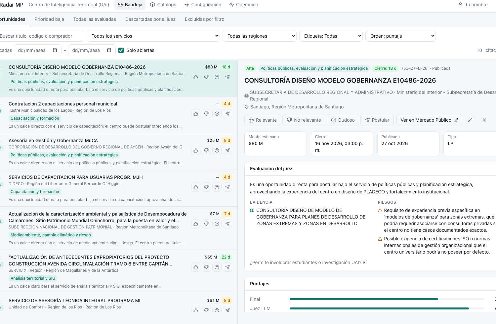
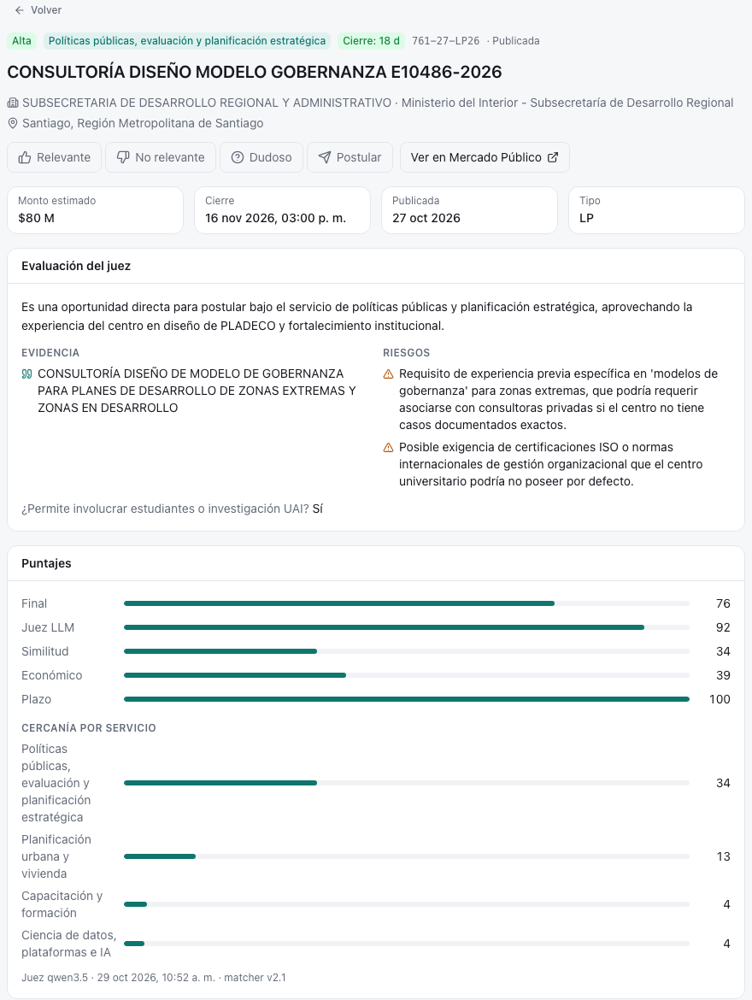
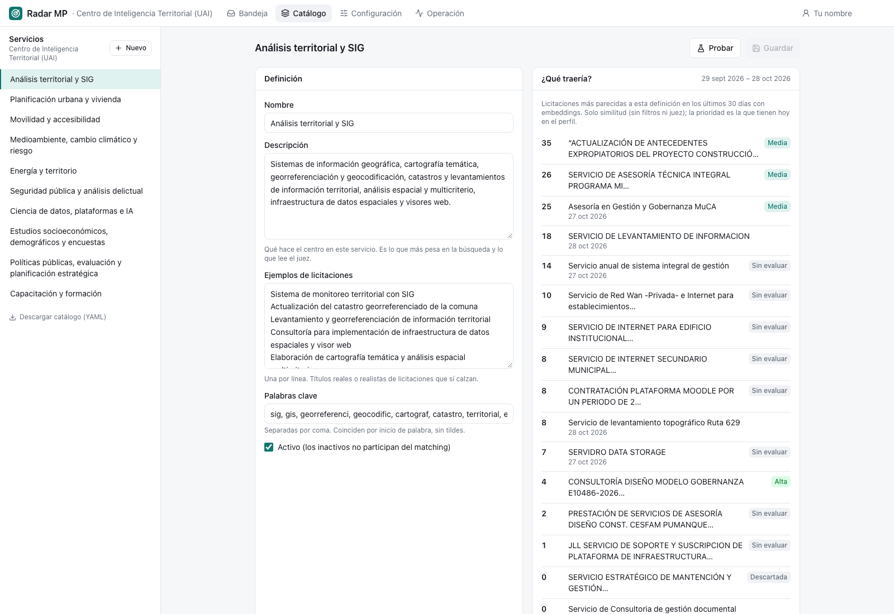
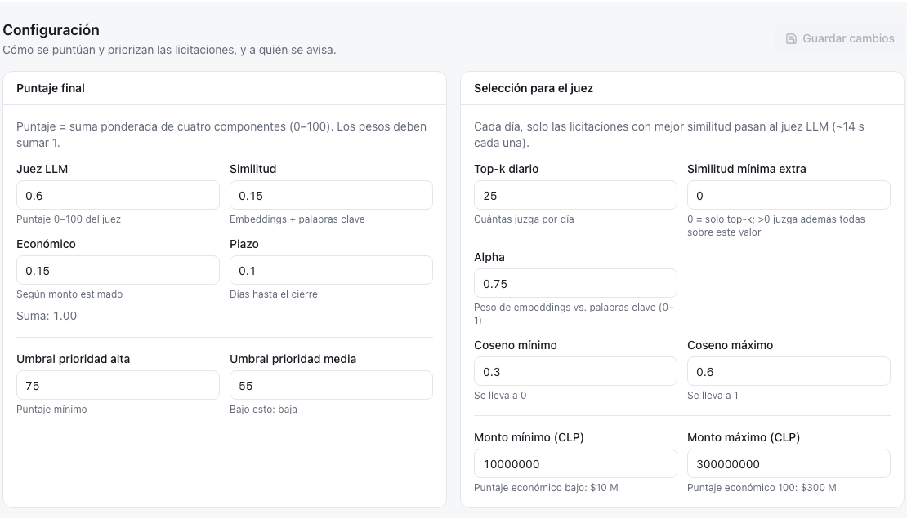
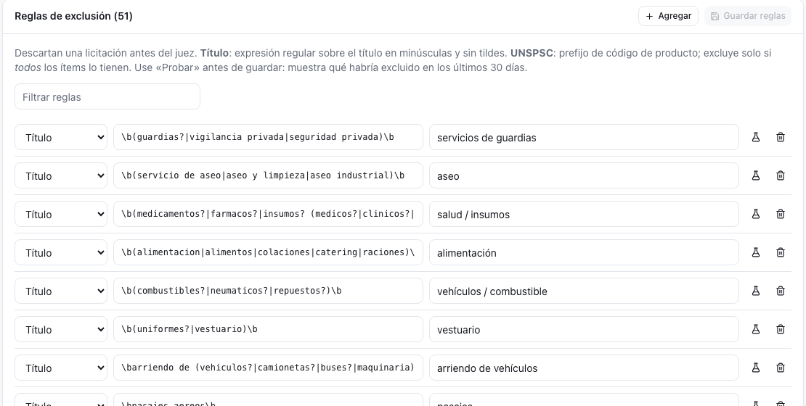
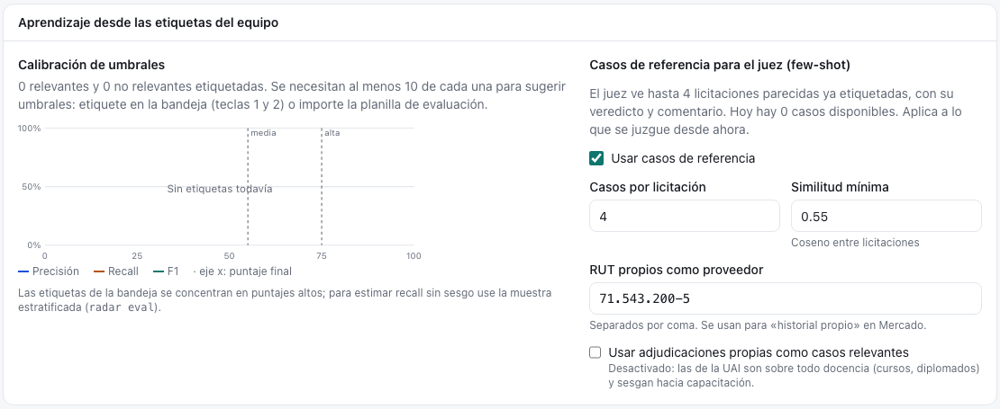
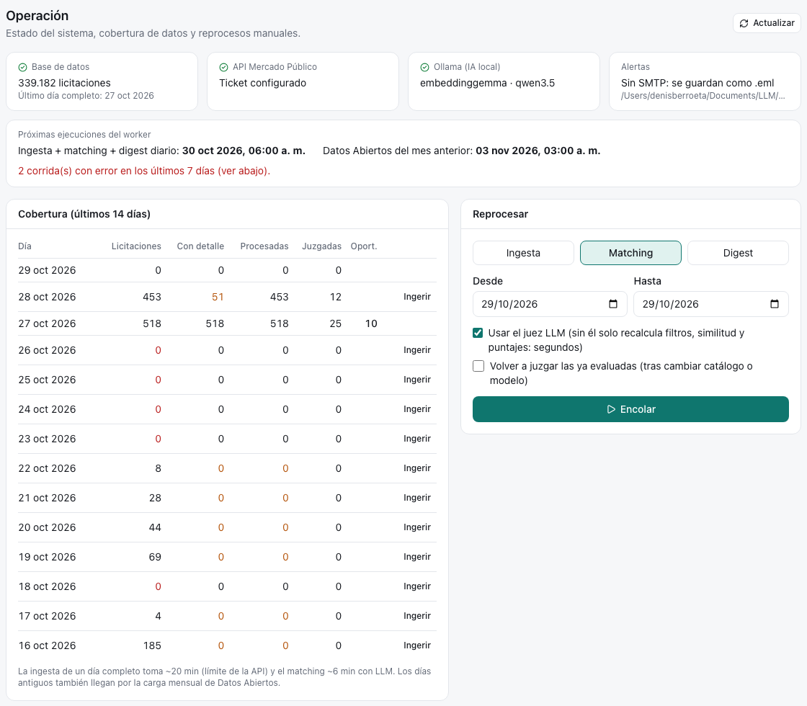

# Pantallas {#sec-pantallas}

La web tiene seis pantallas, más la de inicio de sesión. Las dos primeras son para el trabajo diario de todo el equipo; las otras, para quien administra y mantiene la plataforma. Cada persona ve en el menú solo las pantallas que su rol permite ([Administración](administracion.qmd#personas-roles-y-permisos)).

| Pantalla | Para quién | Para qué |
|---|---|---|
| Bandeja | Lectura en adelante | Revisar oportunidades; etiquetarlas desde jefatura |
| Detalle | Lectura en adelante | Entender por qué una licitación tiene su prioridad |
| Catálogo | Analista en adelante | Describir y probar los servicios de la unidad |
| Configuración | Admin | Ajustar puntaje, triaje, alertas y reglas |
| Operación | Admin | Ver que todo funcione y reprocesar días |
| Usuarios | Admin y superadmin | Crear personas, asignar roles y ver su actividad |

: Pantallas de la web {#tbl-pantallas}

## Bandeja

::: {.captura}
{width="100%"}
:::

Es la pantalla principal: la lista de oportunidades del perfil, ordenada por puntaje. Al seleccionar una fila, se abre a la derecha un panel con su resumen, sin salir de la lista.

**Vistas.** Arriba se elige qué mirar: *Oportunidades* (alta y media), *Baja*, *Evaluadas*, *Descartadas* y *Excluidas*. Las tres últimas sirven para revisar lo que el sistema dejó fuera.

**Filtros.** Servicio, región, etiqueta, fechas, texto libre y «solo abiertas». Los filtros quedan en la dirección de la página, así que una vista filtrada se puede compartir copiando el enlace.

**Teclado.** La bandeja está pensada para revisar rápido sin mouse: `j` y `k` para moverse, `Enter` para abrir, `/` para buscar, `Esc` para cerrar, y `1`, `2`, `3`, `p` para etiquetar ([Usuarios](../digest/usuarios.qmd)).

## Detalle

::: {.captura}
{width="70%"}
:::

El detalle responde la pregunta «¿por qué esta licitación está aquí?». De arriba hacia abajo muestra:

1. **Lo esencial**: prioridad, servicio asignado, monto y días que faltan para el cierre.
2. **La evaluación del juez**: su resumen, la evidencia que citó, los riesgos y si el trabajo permitiría involucrar estudiantes o investigación.
3. **El triaje**: qué respondió el modelo de decisión y qué categoría de entregable eligió.
4. **Los puntajes**: el final y sus cuatro componentes, más la cercanía con cada servicio del catálogo.
5. **Los casos parecidos** que consultó el juez, si los hubo.
6. **El texto completo** de la licitación y sus productos, con la evidencia **resaltada**.
7. **El mercado**: competencia, montos típicos y comportamiento del comprador ([Organismos compradores](../ingest/organismos.qmd)).

## Catálogo

::: {.captura}
{width="100%"}
:::

Muestra los servicios del perfil y permite editarlos: nombre, descripción, ejemplos y palabras clave. Su función más útil es **«Probar»**: antes de guardar un cambio, muestra qué licitaciones de los últimos 30 días traería el servicio con la nueva descripción. Así se ajusta un servicio mirando resultados y no a ciegas. Cómo crear, editar o desactivar servicios se explica en [Administración](administracion.qmd).

## Configuración

::: {.columns}
::: {.column width="49%"}
::: {.captura}
{width="100%"}
:::
:::
::: {.column width="2%"}
:::
::: {.column width="49%"}
::: {.captura}
{width="100%"}
:::
:::
:::

Agrupa en pestañas los criterios del perfil:

- **Puntaje**: los cuatro pesos (deben sumar 1), los umbrales de alta y media y los montos de referencia.
- **Selección para el juez**: cuántas licitaciones juzgar por día y la configuración del triaje.
- **Alertas**: activación, prioridades, destinatarios y vista previa del correo.
- **Reglas**: la lista de reglas de exclusión, cada una con su botón «Probar».
- **Aprendizaje**: la calibración de umbrales con las etiquetas del equipo.

::: {.captura}
{width="80%"}
:::

## Operación

::: {.captura}
{width="100%"}
:::

Es el tablero de salud de la plataforma:

- **Estado** de la base de datos, del acceso a Mercado Público, de los modelos de IA y del correo.
- **Próximas ejecuciones** programadas.
- **Cobertura de los últimos 14 días**: para cada día, cuántas licitaciones se descargaron, cuántas tienen ficha completa, cuántas se procesaron y cuántas oportunidades resultaron, con botones para **completar** los días incompletos.
- **Reprocesos** por rango de fechas: volver a descargar, volver a analizar (con o sin el juez) o volver a generar el correo.
- **Ejecuciones recientes** con su duración y errores.

::: {.callout-tip}
## Usuarios

Lista de las personas con su rol en cada unidad, cuántas etiquetas pusieron y cuántas licitaciones marcaron para postular. Al abrir una persona se ve su historial: inicios de sesión, etiquetas y cambios de rol. Desde aquí se crean cuentas y se asignan roles; las contraseñas y las bajas las gestiona un superadmin. Las reglas se explican en [Administración](administracion.qmd#personas-roles-y-permisos).

## En resumen

- Bandeja y Detalle son para el trabajo diario; Catálogo, Configuración y Operación, para administrar.
- Cada decisión se puede explicar desde el Detalle.
- El capítulo siguiente cuenta cómo se usa todo esto en la rutina del equipo.
:::
