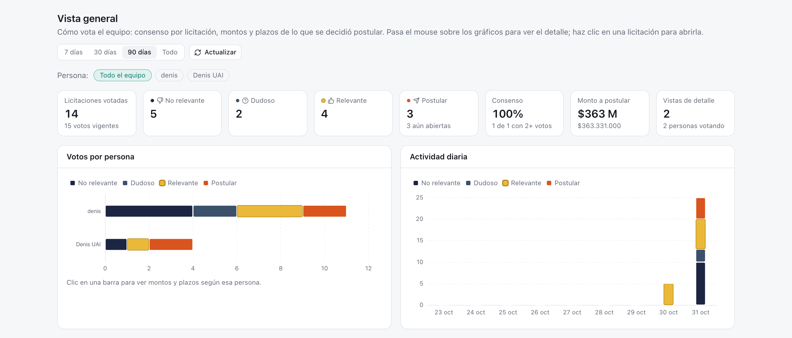
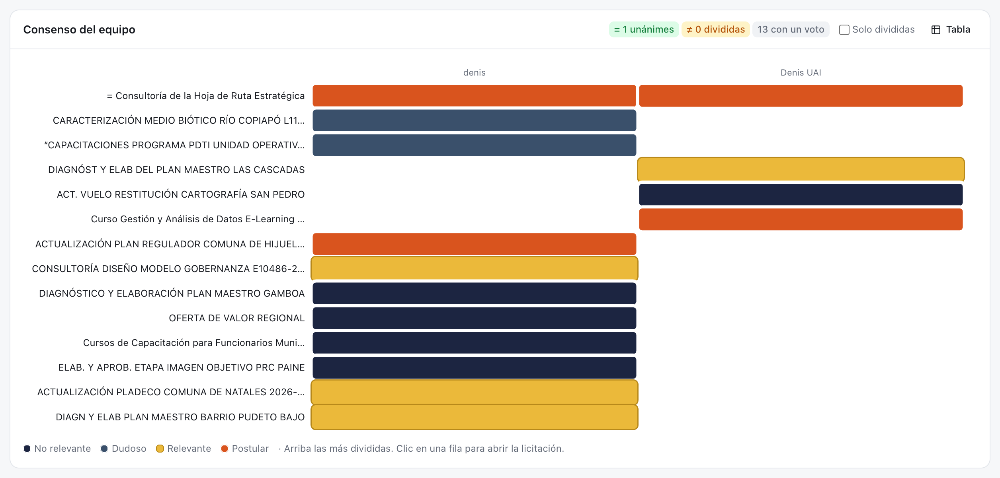
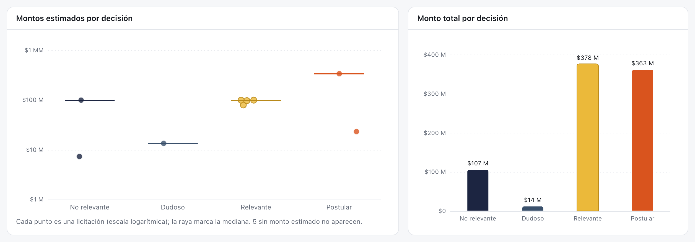
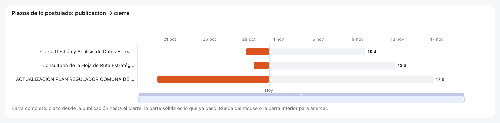
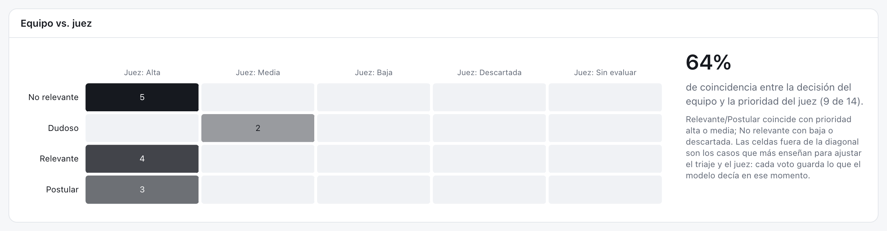

# Vista general {#sec-vista-general}

La vista general muestra **cómo vota el equipo**: cuántas licitaciones etiquetó cada persona, en cuáles coinciden y en cuáles no, cuánta plata hay detrás de cada decisión, cuánto plazo les queda a las que se decidió postular y qué tan de acuerdo está el equipo con el juez. Disponible desde el rol **lectura**, en la segunda pestaña del menú.

La bandeja sirve para decidir licitación por licitación. La vista general sirve para mirar las decisiones **en conjunto**.

::: {.column-page-right .captura}
{#fig-overview width="100%"}
:::

## Qué hay en la pantalla

Todos los gráficos son interactivos: al pasar el mouse muestran el detalle y al hacer clic en una licitación se abre su ficha.

### Período y persona

Arriba a la derecha se elige el **período**: 7, 30 o 90 días (90 por defecto) o todo. **Actualizar** vuelve a consultar los datos.

La fila **Persona** filtra por quién votó. Con *Todo el equipo* cada licitación cuenta con la etiqueta vigente del equipo (o, si no hay, con la opción más votada). Al elegir una persona, los indicadores, los montos y los plazos se recalculan **con sus votos**. Lo mismo pasa al hacer clic en su barra en *Votos por persona*.

### Indicadores

| Indicador | Qué muestra |
|---|---|
| Licitaciones votadas | Cuántas tienen al menos un voto, y cuántos votos vigentes suman |
| No relevante, Dudoso, Relevante, Postular | Cuántas quedaron en cada decisión; en Postular, cuántas siguen abiertas |
| Consenso | Porcentaje de unánimes entre las que tienen dos votos o más |
| Monto a postular | Suma de los montos estimados de lo marcado para postular |
| Vistas de detalle | Cuántas veces se abrió el detalle de una licitación, y cuántas personas votan |

: Indicadores de la vista general {#tbl-overview-kpis}

### Votos por persona y actividad diaria

*Votos por persona* es una barra por persona dividida por decisión. *Actividad diaria* muestra cuántos votos se pusieron cada día, también por decisión, en fecha de Chile.

### Consenso del equipo

::: {.captura}
{#fig-overview-consenso width="100%"}
:::

Una fila por licitación y una columna por persona, con el color de lo que votó cada una. Las licitaciones **más divididas** van arriba. Arriba a la derecha se cuentan las unánimes, las divididas y las que tienen un solo voto. *Solo divididas* deja solo los desacuerdos, y **Tabla** cambia el gráfico por una tabla. Al hacer clic en una fila se abre la licitación.

### Montos

::: {.captura}
{#fig-overview-montos width="100%"}
:::

- **Montos estimados por decisión**: cada punto es una licitación, en escala logarítmica, y la raya marca la mediana de cada decisión. Las que no traen monto estimado no aparecen.
- **Monto total por decisión**: la suma por decisión.

### Plazos de lo postulado

::: {.captura}
{#fig-overview-plazos width="100%"}
:::

Una barra por licitación marcada para postular, desde su publicación hasta su cierre. La parte sólida es el plazo que ya pasó, y una línea marca **hoy**. Al costado se lee cuántos días quedan. Se acerca con la rueda del mouse o con la barra inferior. Las que no tienen fecha de cierre no aparecen.

### Equipo vs. juez

::: {.captura}
{#fig-overview-juez width="100%"}
:::

Una tabla que cruza la **decisión del equipo** (filas) con la **prioridad que le dio la plataforma** (columnas: alta, media, baja, descartada, sin evaluar). A la derecha, el porcentaje de coincidencia. Se cuenta como coincidencia que Relevante o Postular tengan prioridad alta o media, y que No relevante tenga baja o descartada.

Las celdas fuera de esa diagonal son las más valiosas: muestran dónde se equivoca el sistema. Por ejemplo, un **No relevante con prioridad alta** es ruido que llegó a la bandeja.

## Cómo se hace

### Encontrar los desacuerdos del equipo

1. En *Consenso del equipo*, marcar **Solo divididas**.
2. Hacer clic en cada fila para abrir la licitación y conversarla.
3. Cuando el equipo se pone de acuerdo, quien corresponda corrige su voto en la bandeja.

### Revisar lo que hay que preparar

1. Mirar *Plazos de lo postulado*: las barras con menos días van primero.
2. El indicador *Postular* dice cuántas siguen abiertas, y *Monto a postular* cuánto suman.

### Comparar el criterio de una persona

1. Elegir a la persona en la fila **Persona**.
2. Los indicadores, los montos y los plazos pasan a contar sus votos. *Consenso del equipo* sigue mostrando a todos.
3. *Todo el equipo* o la ✕ quitan el filtro.

### Buscar errores del sistema

1. En *Equipo vs. juez*, mirar las celdas **No relevante / Juez: Alta** y **Relevante / Juez: Descartada**.
2. Si se repite un tipo de licitación, ajustar el servicio en el [Catálogo](catalogo.qmd) o una regla en [Configuración](configuracion.qmd#reglas-de-exclusión).

## De dónde salen los datos

La bandeja guarda **una sola etiqueta vigente** por licitación y unidad: si otra persona marca otra cosa, la última gana ([Bandeja](bandeja.qmd#etiquetar)). La vista general, en cambio, reconstruye el **voto vigente de cada persona** a partir de su historial (`user_event`). Por eso puede mostrar en qué no coinciden.

Desde que existe esta pantalla, cada voto guarda además **lo que decían el triaje y el juez en ese momento**. Así, aunque la licitación se vuelva a juzgar después, sigue siendo posible comparar la opinión del equipo con la del modelo que la persona vio. Esa información servirá para entrenar el modelo de decisión y elegir casos de referencia para el juez ([Aprender de las postulaciones](../futuro/aprendizaje-postulaciones.qmd)).

También se registran como eventos las **vistas de detalle** (una por persona y licitación, sin repetir) y los clics en **Ver en Mercado Público**.

## Bitácora

| Fecha | Cambio | Commit |
|:---|:---|:---|
| 31-oct-2026 | Pantalla **Vista general**, para todos los roles: indicadores, votos por persona, actividad diaria, consenso del equipo, montos y plazos por decisión, y equipo vs. juez, con gráficos interactivos (ECharts). Cada voto guarda lo que decían el triaje y el juez, y se registran las vistas de detalle y las aperturas en Mercado Público. | `f658574` |
| 31-oct-2026 | Primera lectura, con los votos de prueba de dos cuentas: 14 licitaciones votadas y 64 % de coincidencia con el juez. Las cinco marcadas No relevante tenían prioridad alta (@fig-overview-juez). | — |

: Bitácora de la Vista general {#tbl-bitacora-vista-general tbl-colwidths="[14,74,12]"}
